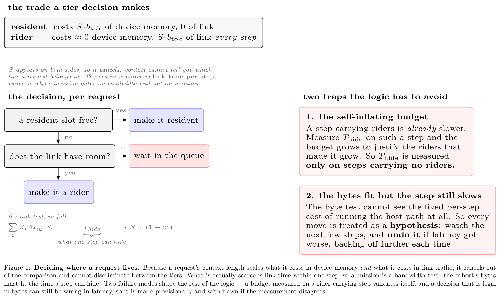
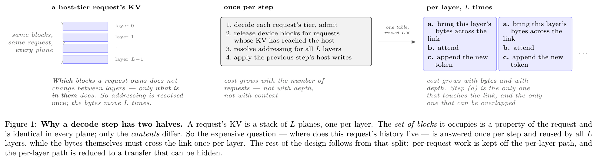
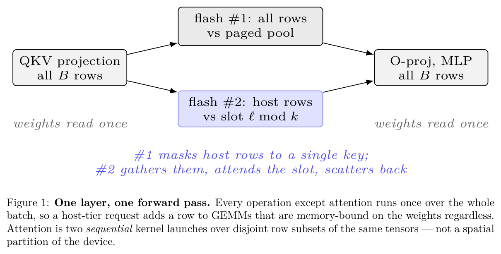
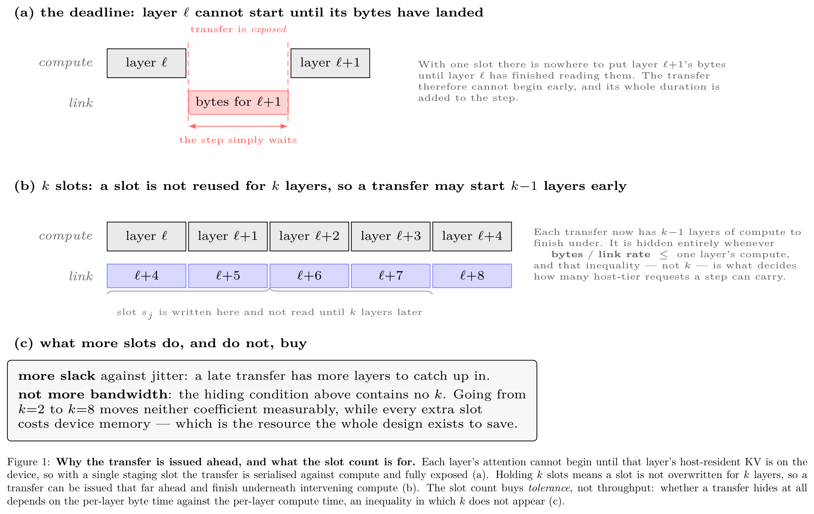
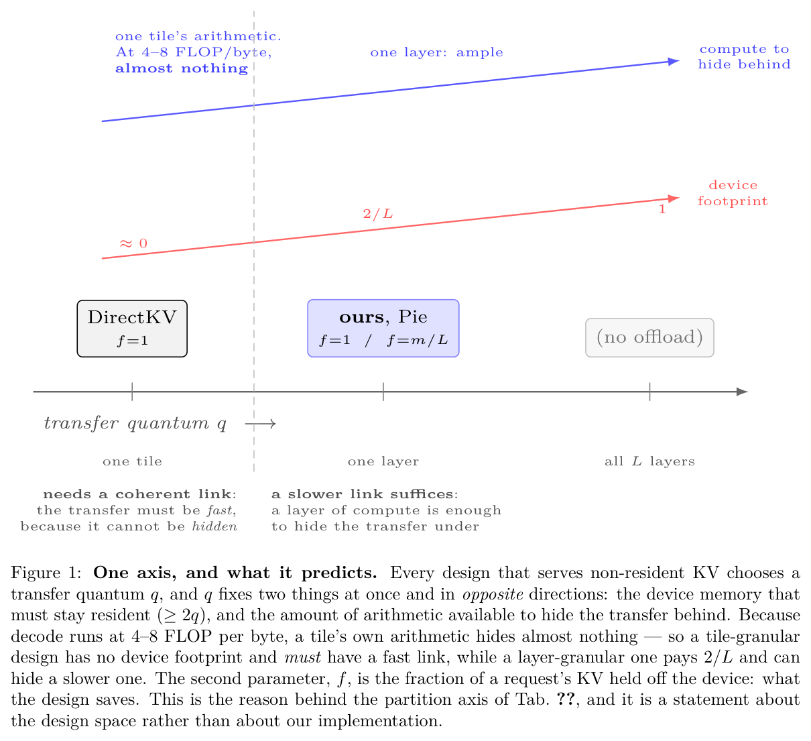

# Co-serving a host-DRAM KV tier: architecture, flows, and the cost floor

What we built, and what forced each part of it to be the way it is. The reader is
assumed to know the problem and why it is worth solving; none of that is repeated
here.

Measured numbers are marked `[M]`. The narrative names no functions or files — where
something lives in the code is in the appendix, so the logic can be read without it.

| § | | figures |
|---|---|---|
| 1 | the mechanism, and the one assumption it rests on | 1 |
| 2 | memory: three address spaces | 2 |
| 3 | the components | — |
| 4 | **the flows** — admission, the step, hiding the transfer, write-back, migration | 3–6 |
| 5 | what the optimisation campaign changed | 7, 8 |
| 6 | the cost floor of any multi-tier KV system | 9 |
| 7 | blocks worth lifting into the paper | — |

---

## 1. The mechanism

***Figure 1.** The data path.*

A decoding request is assigned to one of two **tiers**.

- A **resident** holds its whole KV cache in device memory, in the engine's ordinary
  paged pool, exactly as the unmodified system would.
- A **rider** holds its KV cache in pinned host DRAM. While it is generating it holds
  **no blocks of the device KV pool at all**. The only device memory its KV occupies
  is a share of a small rotating region of `k` layer-slots, shared by every layer and
  every rider.

A rider's prefill blocks are not merely capped — they are **released** back to the
allocator once the worker confirms the KV has reached the host. The release is what
makes this a capacity mechanism rather than bookkeeping, and §2 shows that it also
dictates the memory design.

**Co-serving means three things operationally**, each load-bearing:

1. Both tiers are **rows of the same forward pass**. With `B` residents and `r`
   riders, `B + r` rows pass through every layer. Not alternating steps, not separate
   engines, not a paused state.
2. The model weights are therefore **read once for the whole batch**. A rider adds
   its KV read and nothing else.
3. A rider's generation is **never suspended**: it emits a token on every step it is
   scheduled, like any other request.

### 1.1 The one assumption: disaggregated prefill

A rider's KV arrives from a prefill instance and is written straight into the host
copy, never materialising in device memory. This is a constraint, not a deployment
convenience:

> Device allocation is charged at **peak**. A request that prefilled into the pool
> and then released still raised the peak, and the batch is bounded by peak
> residency. So in a combined prefill-and-decode engine, once the device holds
> `capacity` residents the next request cannot prefill, and therefore never becomes a
> rider. **Riders could only be bought by giving up resident slots.**

`[M]` An earlier design capped a rider's block *growth* without releasing its
prefill. It freed 3% / 11% / 33% of footprint at generation 256 / 1024 / 4096 while
paying full interconnect every step. A rider whose prefill stays resident frees
nothing while still paying the link, so it is strictly worse than leaving the request
resident — at any bandwidth.

---

## 2. Memory: three address spaces

***Figure 2.** The three spaces, the once-per-step compaction between them, and the
hazard that forces the private host space.*

| space | indexes |
|---|---|
| **private host** | the host copy. One contiguous **extent** per request, freed only when the request finishes |
| **device paged** | the engine's ordinary pool. A rider's prefill lives here briefly, then is released |
| **compacted rolling** | the `k` device slots. Rebuilt once per step |

### 2.1 Why the host copy cannot be addressed by device block id

This is the system's one genuinely forced decision.

The point of the feature is to **release** a rider's device blocks. When the
allocator releases a block it nulls the owner's table entry and returns the id to a
free list, from which it is promptly reissued to someone else. A host copy addressed
by *device* block id would therefore, the moment a release happened:

1. **lose its read mapping** — the owner's entry is now null, so nothing records
   where that KV went; and
2. **alias** — the reissued id now names a different request's data.

Both consequences follow from the release itself, which is the thing the feature
exists to do. Hence a private address space, freed only at the end of a request. An
earlier version addressed the host copy by resident block id and **corrupted KV under
block reuse**.

The predecessor design addresses its compaction by resident block id *because it
frees nothing*. That is why it validated the two-source attention arithmetic and
could never deliver the capacity win: the property that makes the addressing safe is
the property that makes the feature pointless.

### 2.2 The rotation is a pointer change, not a remap

Layer `l` reads slot `l mod k`. Because every slot has the same compacted layout, a
rider's block table is built **once per step** and reused by all `L` layers; only the
base pointer changes between them. The rolling window therefore costs **zero
per-layer addressing work** — a fact §6 depends on.

### 2.3 One sizing caveat

The rolling region is allocated from a *policy maximum* rather than from the live
cohort, so the saving holds **conditional on the window tracking the cohort**. Every
measured run set the size explicitly. A production version would size each extent at
admission from the request's own sampling parameters.

---

## 3. The components

| component | responsibility |
|---|---|
| host pool and extent allocator | the private address space; the host copy; one contiguous extent per request |
| rolling device region | `k` layer-slots, shared by all `L` layers |
| per-step compaction | maps host addresses to slot addresses; produces the step's transfer plan and its single block table |
| deferred token-write | staging for newly generated tokens, and the bookkeeping that lets the host-side write be postponed |
| two-source attention | the second attention call over rider rows, and the gather/scatter around it |
| admission and migration | tier assignment, the bandwidth budget, and the provisional demote/promote loop |

The tier backend is a **protocol**, not a hard-wired path: it separates *which
requests live where* (policy) from *how non-resident KV is stored and read*
(mechanism). A zero-copy kernel that reads host memory in place drops into the same
slot, which makes a competing mechanism a **substitutable component** rather than a
rival design.

---

## 4. The flows

### 4.1 Deciding where a request lives

***Figure 3.** Why admission is a bandwidth test, and the two failure modes that
shape the rest of the logic.*

**The trade.** Putting a request in the host tier frees `S · b_tok` bytes of device
memory, where `S` is its context length. It costs `S · b_tok` bytes of link traffic
**every step**, because the whole history has to be read back for every token it
generates.

**The first consequence is counter-intuitive and drives the whole policy.** Context
length appears on both sides of that trade, so it **cancels**. A long request is not
a better offload candidate than a short one: it frees more memory and costs
proportionally more bandwidth. Context tells you nothing about where a request
belongs.

So the scarce resource is not memory — it is **link time within a single step**.
Admission is therefore a bandwidth test: the cohort's total bytes must fit inside the
time one step can hide. If they do not, the request waits rather than joining the
host tier.

**What the policy scores instead** is *temporal*: how long a request has been idle,
and how much generation it has left. Both bear on how many future steps will pay the
transfer, which is the quantity that actually matters.

**Trap one: a budget that validates itself.** The budget is "how much link time can a
step hide", which has to be measured. But a step that is *already carrying riders* is
already slowed by them. Measuring the budget on such a step inflates it, which admits
more riders, which slows the step further, which inflates the budget again. The
budget is therefore measured **only on steps carrying no riders** — the only
observation that is not contaminated by the decision it informs.

**Trap two: legal in bytes, wrong in latency.** The byte test can only see bytes. It
cannot see the fixed per-step cost of running the host path at all — the bookkeeping,
the extra attention call, the stream ordering — which is paid whether one rider is
present or ten. `[M]` A move that passed the byte test was measured driving
inter-token latency from roughly 6 ms to 24 ms.

The logic therefore treats every migration as a **hypothesis rather than a decision**:
after moving a request, watch the next several steps, compare against the best recent
behaviour rather than the instantaneous average, and **undo the move** if latency got
worse — backing off further each time so a bad decision is not retried immediately.
The comparison uses the recent *minimum* because an instantaneous average picks up
startup transients and can make a harmful move look like an improvement.

### 4.2 The shape of a decode step

***Figure 4.** The structural split that the rest of the design follows from.*

A request's KV is a stack of `L` planes, one per layer. **Which blocks it occupies is
a property of the request and is identical in every plane; only the contents differ.**

That single fact splits the step in two:

- **The addressing question** — *where does this request's history live* — has the
  same answer for all `L` layers. It is expensive to answer, and it is answered
  **once per step**.
- **The bytes** differ per layer and must cross the link **`L` times**.

Keeping those apart is the central structural decision. If addressing were recomputed
per layer, its cost would be multiplied by depth and would land on the hot path;
instead the per-layer path is reduced to a transfer, which is the one thing that can
be overlapped with compute.

**Once per step, before any layer runs**, in order and for a reason:

1. **Observe and decide.** Record how long the previous step took (used for the
   budget only if that step carried no riders), consider migrations, and admit
   waiting requests.
2. **Release.** Return device blocks belonging to riders whose KV reached the host,
   as confirmed by the worker on the previous step. This is where capacity is
   actually recovered.
3. **Resolve addressing.** Work out which host blocks each rider needs, map them onto
   the dense slot region, and build the single block table all `L` layers will use.
4. **Settle the previous step's host writes.** Explained in §4.4; it is here because
   this is the last moment before anything reads the host copy again.

**Per layer, `L` times:**

| | what | why here |
|---|---|---|
| a | bring this layer's rider KV across the link into the current slot | must land before attention reads it |
| b | run attention over **all** `B + r` rows | one call for the resident cohort |
| c | write this step's new key and value into the slot | a rider must attend its own just-generated key |
| d | run a **second** attention call over the rider rows against the slot | the rider KV is in a different region, which a single call cannot address |
| e | place those results back into the output | — |

***Figure 5.** Everything except attention runs once over the whole batch; only
attention is split, and only because the two cohorts' KV lives in two places.*

**Why riders ride the main attention call at all.** The shipped path runs the main
call over every row, including riders, with each rider masked down to a single key,
and then overwrites those rows with the result of the second call. It would seem
cheaper to exclude them. It is not, for a structural reason: the batch is one set of
tensors, and carving the rider rows out of the main call means the two cohorts no
longer share it. `[M]` Leaving the rider rows unmasked instead — letting them do full
work twice — costs 22% of wall time, which is what the masking avoids.

This also means **the two tiers are not two disjoint passes.** The shipped path is
one full pass plus a rider override. The disjoint-pass description belongs to the
predecessor design, and a reader who assumes it will mis-predict where cost lands.

### 4.3 Hiding the transfer

***Figure 6.** Why the transfer is issued ahead, and what the slot count is actually
for.*

**The deadline.** Layer `l`'s attention cannot begin until layer `l`'s rider KV is on
the device. That is a hard ordering constraint, and it is the only one.

**Why one staging slot is not enough.** With a single slot there is nowhere to put
the next layer's bytes until the current layer has finished reading them. The
transfer cannot start early, so its entire duration is added to the step — the link
and the compute run strictly in sequence.

**What `k` slots buy.** With `k` slots, a slot written now is not read again for `k`
layers. A transfer can therefore be issued `k−1` layers before its deadline and
finish underneath the intervening compute. This is the whole of the overlap.

**What `k` does not buy — and this is the part most easily misread.** Whether a
transfer hides at all depends on a comparison that contains no `k`:

> bytes for one layer ÷ link rate  ≤  one layer's compute time

More slots give a late transfer more room to catch up — tolerance against jitter —
but they do not raise the rate at which bytes cross the link, and so they do not
raise how many riders a step can carry. `[M]` Going from `k = 2` to `k = 8` moves
neither cost coefficient measurably, while every extra slot costs device memory, which
is the resource the design exists to save.

**One irreducible exposure.** Nothing is prefetched across a step boundary: the first
layer's transfer is issued when the step begins, so at least one layer's worth of
transfer per rider is always exposed. It is small — roughly `1/L` of a rider's byte
time — but it is not zero, and it is the reason the per-rider cost is not purely host
work.

### 4.4 Keeping the authoritative copy correct

A newly generated key and value must reach **two** places, and the two have very
different urgency:

- **The device slot**, immediately. The rider attends its own just-computed key
  within this very layer, so this write cannot be postponed by even one step.
- **The host copy**, which is authoritative, eventually.

**The naive version is what makes the feature slow.** Writing to the host
synchronously, per layer, means the host waits on the device twice per layer — `2L`
stalls per step, each one draining the pipeline.

**The observation that removes them.** The host copy is not read again until the
*next* step's transfers. Nothing between now and then depends on it. So the write can
be issued asynchronously, accumulated in a staging area, and **applied in bulk at the
next step's boundary** — which is exactly why "settle the previous step's host
writes" is the last thing that happens before a step begins reading the host copy
again. One wait replaces `2L`.

**Why the obvious correctness fix is unaffordable.** The deferred write and the
in-flight transfers touch the same host memory, so the tidy solution is to order them
explicitly against each other. `[M]` Doing so moves the per-rider cost from about
0.9 ms to about 7.0 ms — it costs the entire overlap. The reason is that the transfer
machinery always has outstanding work, so synchronising against it is close to a full
device synchronisation. The hazard is intrinsic to the host running a step ahead of
the device, and any host-side ordering pays for that whole gap. What makes the
deferral safe instead is the *scheduling* argument above: the write lands before the
only thing that reads it.

### 4.5 Moving a request between tiers

**Getting KV to the host** happens one of two ways: delivered from outside, which
never touches device memory, or gathered from the request's own resident blocks, which
is used for migration and single-engine experiments.

**Why an acknowledgement is needed.** The scheduler cannot observe a host-side write.
Anything conditioned on the KV having actually arrived — above all, releasing the
device blocks — must wait for the worker to confirm it. Releasing early would free
blocks whose contents had not yet been copied.

**Promotion is two-phase**, and the reason is a subtlety in how block tables are
accounted. While a request is a rider its table has been emptied, but **a nulled
entry still counts toward the length**. A naive gate asking "do the blocks cover the
sequence?" therefore **passes on an entirely empty table and serves garbage.** So
promotion first marks the request and refills the gaps, gates on *non-null* entries
and refuses partial coverage, and only then commits and copies the history back.

A related constraint: the waiting queue stops at the first request it cannot allocate
for. A request needing *no* resources can therefore be starved behind one that does,
so host-tier admission has to bypass the queue rather than join it.

---

## 5. What the optimisation campaign changed

***Figure 7.** The host path as first built (a) and as it stands (b).*

***Figure 8.** The two coefficients as reduced, with the profitability gate drawn
across panel (b).*

Per-step overhead obeys `ΔT = F + c·r`: `F` fixed per step, `c` per rider.

**The fixed cost**, `[M]` 37.02 → 24.78 → 20.05 → 16.10 → 12.29 ms, was four sites of
**one species**: loop-invariant work executed inside the per-layer loop. The worst was
a device-side reduction evaluated once per layer *inside a guard whose purpose was to
skip expensive KV reads* — an optimisation paying a full pipeline drain per layer to
decide whether to optimise. Then the deferred write took off 7.6, the vectorised
settle 0.32, and the flush defect 2.0, giving `[M]` **3.36 ms at L=64**.

**The per-rider cost.** The first addressing implementation did one host-level
assignment per rider *block* per step, `[M]` 3.917 ms/rider at context 8192 and
**growing with context**. Reducing it to one assignment per *request* — which the
contiguous-extent guarantee permits — gives `[M]` 0.00313 ms/rider, independent of
context. The final coefficient measured below the knee is `[M]` 0.52 ms/rider at
L=64.

> The three points in panel (b) are **not a single ladder**: the first two were fitted
> across the knee, the last below it. They are the same quantity measured under
> different protocols.

### 5.1 The ledger

| | change | outcome |
|---|---|---|
| **T1** | addressing made per-request instead of per-block | **landed**: 3.917 → 0.00313 ms/rider, and the term loses its context dependence |
| **T2** | deferred, batched host write | **landed**: `F` 13.4 → 5.8 ms |
| **T7a** | one staging allocation, vectorised settle | **landed**: −0.32 ms |
| **T8** | stop a disabled feature flushing per layer | **landed**: −2.0 ms, the largest single win |
| T3 | stage on the device, then one strided transfer | rejected: **6× worse** |
| T4 | batch the host writes across layers | rejected unbuilt: **18% worse** off-engine |
| T5 | issue whole extents | **null**: launches ÷8, neither coefficient moved |
| T6 | order the deferred write against its readers | rejected: costs **the entire overlap** |
| T7b | preallocated buffers | null |

**T8 was a defect, not an optimisation.** A feature that is off by default was
flushing the batched host write 64 times per step, because its call site tested that
the code path *existed* rather than that the feature was *enabled*. It had silently
defeated the batching from the day the batching landed.

Two results constrain what can still be done. **T5 cut the launch count eightfold and
moved neither coefficient**, which rules out a launch-bound account of the fixed cost
and points instead at the per-layer stream ordering. **T3 achieved exactly the
bandwidth improvement predicted for it in isolation and was six times slower in the
engine**, because a strided copy out of pinned memory is assembled on the host first —
reintroducing precisely the gather the memory layout exists to avoid. Four of the nine
changes had a mechanism that demonstrably fired and a benefit that did not follow, so
remaining candidates are priced off-engine or by ablation before they are built.

### 5.2 What the fixed cost is made of now

| component | ms at L=64 | how obtained |
|---|---|---|
| second attention call | **1.21** | direct ablation, three baselines agreeing to 0.09 |
| — kernel and its launch | 1.16 | kernel-only ablation |
| — gather and scatter | −0.05 in `F`, **+0.134 in `c`** | difference of the two ablations |
| everything else fixed | **2.15** | by difference |
| — the per-layer host-write launches | 0.834 | measured off-engine |
| — unattributed | ~1.3 | open |

The gather and scatter **size with the rider count**, so they belong to `c`, not `F` —
which is why subtracting them inside `F` returns a zero, and why a fixed-cost-only
decomposition cannot see them at all.

---

## 6. The cost floor of a multi-tier KV system

What *any* system co-serving two KV tiers in one forward pass must pay per decode
step, and where this implementation sits against it. Rows are tagged **(a)** forced by
the mechanism, **(b)** forced by a substrate with a stated property, **(c)** ours.

### 6.1 The obligations

| | obligation | escapable? |
|---|---|---|
| C1 | move the KV across the link, once per step | no — identity |
| C2 | land layer `l`'s KV before layer `l`'s attention | no |
| C3 | hold at least two transfer quanta on the device | no |
| C4 | pass each KV byte through device memory twice, staged | only by a zero-copy kernel |
| C5 | tell attention which address space each row reads | no |
| C6 | order the transfer against compute | only by pipelining inside the kernel |
| C7 | get the new token to the authoritative copy | no |

### 6.2 Floor, base, optimised

`S` = context, `r` = riders, `L` = layers, `X` = achieved link bandwidth,
`b_tok` = bytes per token of KV.

| # | component | **floor** | our **base** | our **optimised** | at the floor? |
|---|---|---|---|---|---|
| C1 | link bytes | `b_tok·Σᵢ Sᵢ` per step | identical | identical | **yes** — identity |
| C2 | exposure | ≥ 1 quantum per rider | **all of it**, issued inline | `1/L` of the byte time | **yes**, to measurement resolution |
| C3 | device residency | `2q`; saving `1 − k·q/L` | `k=4` | `k=4` | **no** — `k=2` measures the same |
| C4 | memory passes | `2×` staged, `1×` direct | `2×` | `2×` | at the **staged** floor |
| C5a | addressing | `O(r)` per step | `O(blocks)`, growing with `S` | **per-request**, context-free | **yes** — right complexity class |
| C5b | tier dispatch | 1 extra dispatch per layer | 1.21 ms | 1.21 ms | **yes** for a fixed kernel |
| C5c | row gather/scatter | `0` if rider rows are batch-contiguous | 0.134 ms/rider | 0.134 ms/rider | **no** — a batch reorder would remove it |
| C6 | ordering operations | `Ω(L)` per step; `0` intra-kernel | `2L` **blocking** | `L` waits + `L` records, non-blocking | **yes** for a copy-engine design |
| C7a | transfer launches | `2L` | `2rL` | `2rL` (`2L` available, default off) | **no** — the `r` is allocator fragmentation |
| C7b | host-side gather | `0` with a contiguous layout | **22 ms/layer** | **0** | **yes** — eliminated |
| C7c | write-back crossings | `O(1)` per step | `2L` blocking | `2L` async, deferred, batched | **no** — `O(1)` route unknown |
| C7d | settling the host copy | `O(1)` per step | `2L` per-layer | **2** vectorised | **yes** |

**At or near the floor on 7 of 12.** Three are open with a known route: C5c (reorder
rider rows to be contiguous), C7a (tighter extents — the mechanism exists and is off
by default), C3 (`k = 2` instead of 4, which `[M]` measures the same). Two are open
with no known route: C7c, where the one path we priced is 18% *worse*, and C4 at `1×`,
which needs a different mechanism entirely.

Two caveats belong with the table. The 0.834 ms figure is **this host's cost for this
launch pattern**, not a floor — the count floor is `O(1)` crossings per step. And
per-block addressing is fatal *at interpreted-language constants*; a compiled
implementation of the same algorithm would never bind.

### 6.3 The axis that organises the twelve rows

***Figure 9.** The quantum fixes device footprint and hideable compute in opposite
directions.*

Two parameters describe any such design: `f`, the fraction of a request's KV held off
the device (what it saves), and `q`, the transfer quantum it pipelines at (what it
pays).

> `q` sets **both** the device footprint (`≥ 2q`) **and** the arithmetic available to
> hide the transfer behind — in opposite directions.

Because decode runs at 4–8 FLOP per byte, a tile's own arithmetic hides almost
nothing. So a tile-granular design has no device footprint and **must** have a fast
link; a layer-granular one pays `2/L` and can hide a slower one. Ours is
`f = 1, q = one layer`.

This is also why a single fused attention call and a `k < L` rolling region pull
against each other: one call needs one block table, and `k = L` would multiply the
rolling region by `L/k`. Fusing is not deferred work, it is the other end of the same
trade. `[M]` Its ceiling, measured by ablating the call rather than projecting, is
+2.0 points certain and +8.5 at best.

### 6.4 When the mechanism pays

- A rider must cost less than a resident is worth: **`c < T₀/B`**. Below that, no
  rider count helps at any bandwidth — which is what per-block addressing failed,
  `[M]` 5.17 against a 3.37 ms budget.
- Usable rider count is **`⌊r*⌋`**, `r* = T₀·X/(S·b_tok)` — an integer, so gain is a
  **sawtooth** in context. It contains no `k`.
- Gain tracks **how much of device memory the weights took**, not context: context
  appears in both the memory freed and the bytes moved, and cancels. The same
  cancellation that forces the admission policy to score on time rather than length.

---

## 7. The blocks worth lifting into the paper

| block | from | why |
|---|---|---|
| **1. The floor table** | §6.2 | the only part about the *class* rather than about us; the base/optimised columns are what license "near the floor" over "measured" |
| **2. The `(f,q)` axis** | §6.3 | turns related work into points on one curve, and predicts which link each design needs |
| **3. Base vs optimised** | §5 | one figure carries the whole campaign |
| **4. The forced address space** | §2.1 | the cleanest "forced by the substrate" argument, and it ends in a corruption bug |
| **5. The two traps in admission** | §4.1 | a self-validating budget and a byte-legal-but-wrong decision are both general to tiered serving |
| **6. The `c < T₀/B` gate** | §6.4 | a one-line design rule with a quantified failure |

---

## Appendix — where this lives in the code

Kept out of the narrative deliberately; the logic above should read without it.

| concept in the text | code |
|---|---|
| host pool, extents, host copy | `vllm/v1/hybrid_rungd_pool.py` |
| per-step compaction and transfer plan | same — `build_step`, `_plan_extents`, `_issue_runs` |
| deferred token-write and its settle | same — `write_token`, `flush_token_writes` |
| the rolling slots | same — `rolling_k`, `rolling_v`, slot `l mod k` |
| second attention call, gather/scatter | `vllm/v1/attention/backends/flash_attn.py` — `_pool_cpu_override` |
| tier backend protocol | `vllm/v1/kv_tier_backend.py` |
| admission, budget, migration probe | `vllm/v1/core/sched/transfer_aware_admission.py` |
| step setup, tier classification, acknowledgement | `vllm/v1/worker/gpu_model_runner.py` |
| release on acknowledgement, queue bypass | `vllm/v1/core/sched/scheduler.py` |

Figure sources are `paper/tex/sections/fig-*.tex`; the PNGs are rendered from them by
`paper/figs/design/render.py`. Paper defects found while reconstructing this are in
`paper/PAPER_DEFECTS.md`.
