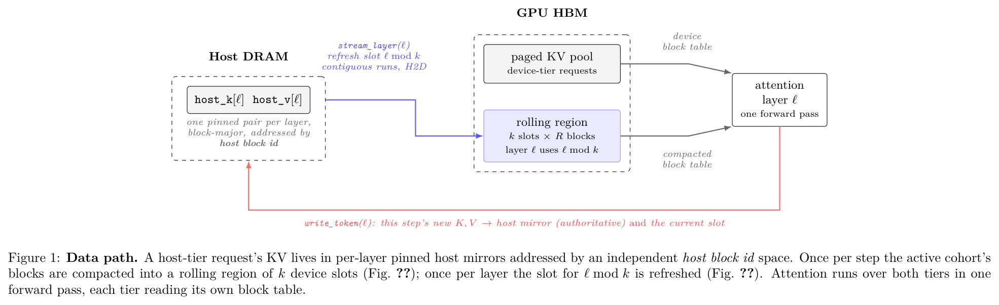
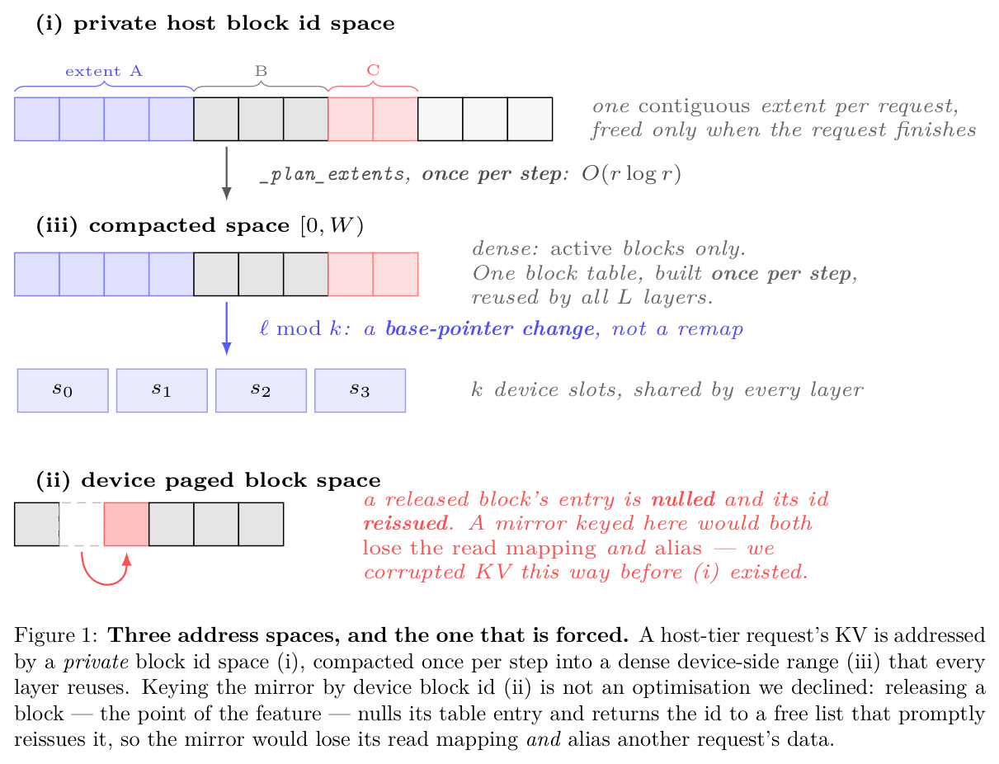
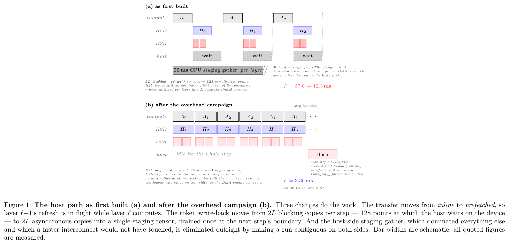
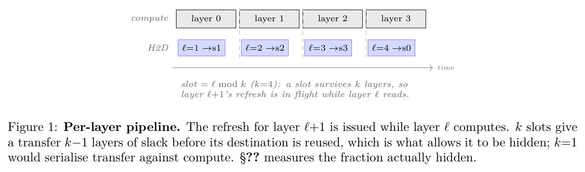

# Co-serving a host-DRAM KV tier: architecture, flows, and the cost floor

What we built, and what forced each part of it to be the way it is. The reader is
assumed to know the problem and why it is worth solving; none of that is repeated
here.

Every measured number is marked `[M]` and is reproducible from the repository.
Figures are TikZ, sourced from `paper/tex/sections/fig-*.tex` and rendered to the
PNGs below by `paper/figs/design/render.py`.

| § | | figure |
|---|---|---|
| 1 | the mechanism, and the one assumption it rests on | Fig. 1 |
| 2 | memory: three address spaces | Fig. 2 |
| 3 | the six components | -- |
| 4 | the flows: admission, the decode step, the pipeline, write-back, promotion | Figs. 3, 4, 5 |
| 5 | what the optimisation campaign changed | Fig. 6 |
| 6 | the cost floor of any multi-tier KV system, and where we sit against it | Fig. 7 |
| 7 | the blocks worth lifting into the paper | -- |

---

## 1. The mechanism

***Figure 1.** The data path. Source `fig-arch.tex`.*

A decoding request is assigned to one of two **tiers**.

- A **resident** holds its whole KV cache in device memory, in vLLM's ordinary paged
  pool, exactly as unmodified vLLM would.
- A **rider** holds its KV cache in pinned host DRAM. While it is generating it holds
  **zero blocks of the device KV pool**. The only device memory its KV occupies is a
  share of a small rotating region of `k` layer-slots, which every layer and every
  rider shares.

A rider's prefill blocks are not merely capped, they are **released** back to vLLM's
allocator once the worker acknowledges that the KV has reached the host mirror. The
release is what makes the feature a capacity feature rather than a bookkeeping one,
and §2 shows why it also forces the memory design.

**Co-serving means three things operationally**, and each is load-bearing:

1. Both tiers are **rows of the same forward pass**. With `B` residents and `r`
   riders, `B + r` rows pass through every layer. Not alternating steps, not separate
   engines, not a paused state.
2. The model weights are therefore **read from HBM once for the whole batch**. A
   rider adds its KV read and nothing else.
3. A rider's generation is **not suspended**: it emits a token on every step it is
   scheduled, like any other request.

### 1.1 The one assumption: disaggregated prefill

A rider's KV arrives from a prefill instance and is written straight into the host
mirror, never materialising in device memory. This is an architectural constraint,
not a deployment convenience, and the reason is specific:

> vLLM charges device allocation at **peak**. A request that prefilled into the pool
> and then released still raised the peak, and the batch is bounded by peak
> residency. So in a combined prefill+decode engine, once the device holds
> `capacity` residents the next request cannot prefill, and therefore never becomes a
> rider. **Riders could only be bought by giving up resident slots.**

`[M]` An earlier design capped a rider's block *growth* without releasing its
prefill: it freed 3% / 11% / 33% of footprint at generation 256 / 1024 / 4096 while
paying full interconnect every step. A rider whose prefill stays resident frees
nothing while still paying the link, so it is strictly worse than leaving the request
resident — at any bandwidth.

The two entry points differ accordingly: `preload_layer` / `preload_req` fill mirror
rows from an external source and never touch HBM; `seed_layer` / `seed_req` gather
from the request's own resident blocks and exist for migration and single-engine
experiments.

---

## 2. Memory: three address spaces

***Figure 2.** The three spaces, the once-per-step compaction between them, and the
hazard that forces the private host space. Source `fig-addr.tex`.*

| space | range | indexes |
|---|---|---|
| (i) private host block id | `[0, h_max)` | the pinned host mirror; one contiguous **extent** per request, freed only at finish |
| (ii) device paged block | `[0, num_gpu_blocks)` | vLLM's ordinary pool. A rider's prefill lives here briefly and is then released |
| (iii) compacted rolling | `[0, W)` | the `k` device slots. Rebuilt once per step |

### 2.1 Why the mirror cannot be keyed by device block id

This is the system's one genuinely forced decision.

The point of the feature is to **release** a rider's device blocks. Under vLLM's
allocator, releasing a block nulls the owner's block-table entry and returns the id
to a free list from which it is promptly reissued. A mirror keyed by *device* block
id would therefore, after a release:

1. **lose the read mapping** — the owner's entry is now null; and
2. **alias** — the reissued id now denotes a different request's data.

Both follow from the release itself, which is the thing the feature exists to do.
Hence a private host space, freed only when the request finishes. An earlier version
mirrored by resident block id and **corrupted KV under block reuse**.

The predecessor design (rung-c) keys its compaction by resident block id *because it
frees nothing* — which is why it validated the two-source attention arithmetic and
could never deliver the capacity win. The property that makes the keying safe is the
property that makes the feature pointless.

### 2.2 The rotation is a pointer change, not a remap

Layer `l` reads slot `l mod k`. Because every slot has the same compacted layout, the
rider block table is built **once per step** and reused by all `L` layers; only the
base pointer changes between layers. The rolling window therefore costs **zero
per-layer addressing work**. This matters for §6.

### 2.3 One sizing caveat

The rolling region is allocated `k * 2 * w_max` blocks, and the runner currently
passes `w_max = h_max` (`gpu_model_runner.py:1387`) — sized by *policy maximum*,
not by the live cohort. The saving `(L-k)/L` holds **conditional on the window
tracking the cohort**; every measured run set the size override. A production version
sizes each extent at admission from the request's own sampling parameters.

---

## 3. The six components

| component | file | owns |
|---|---|---|
| host pool + extent allocator | `hybrid_rungd_pool.py` | the private host block space; the pinned mirror; one contiguous extent per request |
| rolling device region | same | `k` layer-slots, shared by all `L` layers |
| per-step compaction | same — `build_step`, `_plan_extents` | host-id to compact-id map; the transfer runs; **one** block table and `seqused` per step |
| deferred token-write | same — `write_token`, `flush_token_writes` | pinned staging; the pending list; the completion event |
| two-source attention | `flash_attn.py:_pool_cpu_override`, `kv_tier_backend.py` | the second attention call; the gather/scatter; the backend protocol |
| admission + migration | `transfer_aware_admission.py` | tier assignment; the hide budget; demote/promote with a revert probe |

The `KVTierBackend` protocol separates *which requests live where* (policy) from *how
non-resident KV is stored and read* (mechanism). A zero-copy host-reading kernel drops
into the same slot, which makes a competing mechanism a **substitutable component**
rather than a rival design.

---

## 4. The flows

### 4.1 Admission and migration

A free resident slot under the `arrival` policy gives `hbm`. Otherwise
`host_affinity = w·idle + (1−w)·remaining` is scored against a threshold, and the
binding gate is a **byte roofline**: admit only if
`Σᵢ b_tok·Sᵢ ≤ budget_ms · X · (1−margin)`.

Two design points drove this shape:

- The hide budget is an EMA of step time taken **only on steps with zero riders**.
  Otherwise a step already slowed by rider transfer enlarges the budget that admitted
  those riders — a loop that inflates itself.
- Tier affinity is **temporal, not contextual** — idle time and remaining generation,
  never sequence length. Offloading frees bytes proportional to context *and* costs
  link bytes proportional to context every step, so **context cancels** and cannot
  discriminate between tiers at all.

Under the scored policy, migration demotes above `0.95·SLO` and promotes below
`0.70·SLO`. **Every demotion opens a probe** against `min(EMA window)` which reverts
after 16 steps if ITL got worse, then doubles its backoff. The probe exists because
the byte roofline cannot see the host path's fixed per-step cost: `[M]` a byte-legal
demotion was measured driving ITL from ~6 to ~24 ms. The baseline is the recent
*minimum* of the window, because the instantaneous EMA picked up startup transients
and made a harmful demotion look like an improvement.

### 4.2 The decode step

***Figure 3.** The per-layer structure. Source `fig-exec.tex`.*

**Once per step, before layer 0:**

| # | what |
|---|---|
| S1 | observe the previous step's time (feeds the hide budget only if that step had zero riders); plan migrations; admit |
| S2 | a rider past prefill gets an **empty** block allocation — this is the capacity win |
| S3 | release pool blocks for riders the worker acknowledged last step |
| S4 | classify rows by tier; build the rider row and query index lists |
| S5 | **flush** the previous step's deferred mirror writes — one event wait, two vectorised host scatters |
| S6 | plan extents into runs and compact bases; build the `[r, max_blk]` block table and `seqused`, `O(r log r)` |
| S7 | publish index tensors; mark rider rows `−1` in the slot mapping so vLLM's cache write skips them |

**Per layer, L times:**

| # | what | overlapped? |
|---|---|---|
| L1 | QKV, RoPE, vLLM's cache write (rider rows write nowhere) | — |
| L2 | attention over all `B + r` rows, rider rows masked to one key | — |
| L3 | **transfer**: mirror → rolling slot `l mod k`, one contiguous copy per run per tensor | **yes** |
| L4 | gather this step's new K and V for the rider rows | — |
| L5 | write them into the rolling slot; async copy toward pinned staging | copy **yes** |
| L6 | gather rider queries; **second attention call** over `r` rows, reusing the step's one block table | — |
| L7 | scatter the result over the masked rows | — |

Plus one stream wait and one event record per layer, to order the prefetch against
compute.

Two properties of the shipped path worth stating explicitly, because both are easy to
misread from the design intent:

- **The resident cohort is not isolated from the riders.** L2 runs over all `B + r`
  rows and L6 overwrites the rider rows. "Two tiers, two disjoint passes" describes
  the rung-c predecessor, not this path, which is one full pass plus a rider override
  (`gpu_model_runner.py:1139` — the resident index set is empty). `[M]` Not masking
  the rider rows at L2 costs 22% of wall time.
- **Nothing prefetches across the step boundary.** Layer 0's transfer is issued
  synchronously, so at least one quantum per rider is always exposed.

### 4.3 The pipeline, and what the campaign changed about it

***Figure 4.** The host path as first built (a) and as it stands (b). Source
`fig-basevsopt.tex`.*

***Figure 5.** Why (b) can prefetch at all: a slot survives `k` layers, so layer
`ℓ+1`'s refresh is in flight while layer `ℓ` reads. Source `fig-pipeline.tex`.*

Three structural differences between the panels:

1. **The transfer moved from inline to prefetched.** Issued on a side stream with
   `k−1` layers of slack.
2. **The write-back moved from blocking to deferred.** `2L` blocking `.to("cpu")`
   calls per step — 128 points at which the host waits on the device — became `2L`
   asynchronous copies into a single pinned `[L, n, ·]` staging tensor, drained once
   at the next step's boundary by two vectorised scatters.
3. **The host-side staging gather disappeared.** The mirror was originally one
   `[2, heads, blocks, …]` tensor per layer, so a run of blocks was two chunks strided
   by a whole K/V plane, and **a strided H2D cannot be a plain pinned DMA** — torch
   materialises the run on the host first. `[M]` 22 ms per layer, 98% of
   `stream_layer` and 72% of the engine's wall clock. Re-laid out block-major with K
   and V as separate tensors, a run is one contiguous byte range on both sides and the
   DMA engine does the compaction: `[M]` 1.38 ms per layer, 4.87 → 24.38 GB/s.

K and V must be separate tensors, not one `[W, 2, …]`: attention needs
`key_cache`/`value_cache` as contiguous `[blocks, bs, nkv, hd]`, and dim-0 indexing a
block-major tensor yields a strided view flash cannot take.

### 4.4 The write-back, and why deferring it is safe

`_issue_runs` re-reads the mirror on the hot path on the **next** step, so the scatter
must land before it — which is exactly why `flush_token_writes` is the first thing
`build_step` does. The device-side write into the rolling slot is *not* deferrable: a
rider attends its own just-computed key, so that key must be in the readable region
before L6.

`[M]` Ordering the scatter against its in-flight readers — the correct-by-
construction alternative — moves the per-rider cost from ~0.9 to ~7.0 ms, because the
copy stream always has outstanding work and synchronising it is close to a full
device sync. The hazard is intrinsic to the host running a step ahead of the device.

### 4.5 Seeding, reclaim, promotion

Seeding is `preload_req` (external delivery, never touches HBM) or `seed_req` (gather
from the request's own resident blocks). Either way the pool blocks are released
**only** after the worker acknowledges, through
`ModelRunnerOutput.kv_tier_seeded_req_ids`.

Promotion is two-phase: mark and lift the block cap, refill the holes the cap left in
the block table, gate on coverage, then commit and copy host → resident before
attention. Three vLLM behaviours force this shape:

- **The scheduler cannot observe a host-side write**, so anything conditioned on KV
  having arrived must wait for a worker acknowledgement.
- **The waiting queue stops at the first request it cannot allocate for**, so a
  block-starved request ahead would otherwise block an admission that needs no
  resources — hence a queue bypass.
- **Block accounting is length-based**, so a nulled entry still counts as present: a
  gate asking "do the blocks cover the sequence?" **passes on an all-null table and
  serves garbage.** Refill is therefore all-or-nothing and the gate counts *non-null*
  entries.

---

## 5. What the optimisation campaign changed

***Figure 6.** The two coefficients as reduced, with the gate `c < T₀/B` drawn across
panel (b). Source `fig-ladder.tex`.*

Per-step overhead obeys `ΔT = F + c·r`: `F` fixed per step, `c` per rider.

**The fixed cost**, `[M]` 37.02 → 24.78 → 20.05 → 16.10 → 12.29 ms, was four sites of
**one species**: loop-invariant work executed inside the per-layer loop. The worst was
a device reduction plus a `.item()` evaluated once per layer *inside a guard whose
purpose was to skip expensive KV reads* — an optimisation paying a full pipeline drain
per layer to decide whether to optimise. Then T2 (deferred write) −7.6, T7a
(vectorised scatter) −0.32, T8 −2.0, giving `[M]` **3.36 ms at L=64**, three arms
agreeing to 0.09.

**The per-rider cost.** The first block-table build did one host-level assignment per
rider *block* per step, `[M]` 3.917 ms/rider at ctx 8192 and **growing with context**.
Making it `O(r)` — one slice assignment per request, which the extent allocator's
one-run guarantee permits — gives `[M]` 0.00313 ms/rider, context-independent. The
final coefficient measured below the knee is `[M]` `c(L) = 0.177 + 0.0054·L`, i.e.
0.52 ms/rider at L=64.

> The three points in panel (b) are **not a single ladder**: 5.17 and 1.26 were fitted
> across the knee, 0.52 below it. They are the same quantity under different
> protocols.

### 5.1 The ledger

| | change | outcome |
|---|---|---|
| **T1** | `O(r)` addressing from the extent guarantee | **landed**: 3.917 → 0.00313 ms/rider, and the term loses its context dependence |
| **T2** | deferred, batched mirror write | **landed**: `F` 13.4 → 5.8 ms |
| **T7a** | one pinned allocation, vectorised scatter | **landed**: −0.32 ms |
| **T8** | stop a disabled feature flushing per layer | **landed**: −2.0 ms, the largest single win |
| T3 | staged D2D then one strided D2H | rejected: **6× worse**, 4.6 vs 22.3 GB/s |
| T4 | batch the crossings across layers | rejected unbuilt: **18% worse** off-engine |
| T5 | whole-extent runs | **null**: launches ÷8, neither coefficient moved |
| T6 | order the mirror scatter after its readers | rejected: costs **the entire overlap** |
| T7b | preallocated rider buffers | null |

T8 was a **defect, not an optimisation**: a feature that is off by default — the
swap-semantics emulation — was flushing the batched mirror write 64 times per step,
because its call site tested that the method *existed* rather than that the feature
was *enabled*. It had silently defeated T2's batching from the day T2 landed.

Two of these constrain what can still be done. **T5 cut the launch count eightfold
and moved neither coefficient**, which rules out a launch-bound account of `F` and
points instead at the per-layer ordering operations. **T3 achieved exactly the
bandwidth improvement predicted for it in isolation and was six times slower in the
engine**, because a strided copy from pinned memory is materialised on the host first
— reintroducing the gather the layout exists to avoid. Four of the nine had a
mechanism that demonstrably fired and a benefit that did not follow, so remaining
candidates are priced off-engine or by ablation before they are built.

### 5.2 What `F = 3.36 ms` is made of

| component | ms at L=64 | how obtained |
|---|---|---|
| second attention call | **1.21** | direct ablation, same job, 3 baselines agreeing to 0.09 |
| — kernel + launch | 1.16 | `nokernel` arm |
| — gather/scatter | −0.05 in `F`, **+0.134 in `c`** | `noattend` minus `nokernel` |
| everything else fixed | **2.15** | by difference |
| — the `2L` D2H launch pattern | 0.834 | off-engine |
| — unattributed | ~1.3 | open |

The gather and scatter **size with the rider count**, so they live in `c`, not `F` —
which is why subtracting them inside `F` returns a zero, and why a fixed-cost-only
decomposition cannot see them.

---

## 6. The cost floor of a multi-tier KV system

What *any* system co-serving two KV tiers in one forward pass must pay per decode
step, and where our implementation sits against it.

Each row is tagged **(a)** forced by the mechanism, **(b)** forced by a substrate with
a stated property, or **(c)** ours — and only (a) rows are properties of the class.

### 6.1 The obligations

| | obligation | escapable? |
|---|---|---|
| C1 | move the KV across the link, once per step | no — identity |
| C2 | land layer `l`'s KV before layer `l`'s attention | no |
| C3 | hold ≥ 2 transfer quanta on the device | no |
| C4 | pass each KV byte through HBM twice (staged) | only by zero-copy |
| C5 | tell attention which address space each row reads | no |
| C6 | order the transfer against compute | only by intra-kernel pipelining |
| C7 | get the new token to the authoritative copy | no |

### 6.2 Floor, base, optimised

`S` = context, `r` = riders, `L` = layers, `X` = achieved link bandwidth,
`b_tok` = bytes per token of KV.

| # | component | **floor** | our **base** | our **optimised** | at the floor? |
|---|---|---|---|---|---|
| C1 | link bytes | `b_tok·Σᵢ Sᵢ` per step | identical | identical | **yes** — identity |
| C2 | exposure | ≥ 1 quantum per rider | **all of it**, issued inline | `1/L` of the byte time | **yes**, to measurement resolution |
| C3 | device residency | `2q`; saving `1 − k·q/L` | `k=4` → `4/64` | `k=4` → `4/64` | **no** — `k=2` measures the same |
| C4 | HBM passes | `2×` staged, `1×` direct | `2×` | `2×` | at the **staged** floor |
| C5a | addressing metadata | `O(r)` per step | `O(blocks)`: 3.917 ms/rider, growing with `S` | **0.00313 ms/rider**, context-free | **yes** — right complexity class |
| C5b | tier dispatch | 1 extra dispatch per layer | 1.21 ms | 1.21 ms | **yes** for a fixed kernel |
| C5c | row gather/scatter | `0` if rider rows are batch-contiguous | 0.134 ms/rider | 0.134 ms/rider | **no** — batch reorder would remove it |
| C6 | ordering ops | `Ω(L)` per step; `0` intra-kernel | `2L` **blocking** syncs | `L` waits + `L` records, non-blocking | **yes** for a copy-engine design |
| C7a | transfer launches | `2L` | `2rL` | `2rL` (`2L` with whole-extent, default off) | **no** — the `r` is allocator fragmentation |
| C7b | host-side gather | `0` with a contiguous layout | **22 ms/layer** | **0** | **yes** — eliminated |
| C7c | write-back crossings | `O(1)` per step | `2L` blocking | `2L` async, deferred, batched | **no** — `O(1)` route unknown |
| C7d | mirror scatter | `O(1)` per step | `2L` per-layer | **2** vectorised | **yes** |

**At or near the floor on 7 of 12.** Three are open with a known route — C5c (batch
reorder, worth 0.134 ms/rider), C7a (tighter extents; the mechanism exists and is
default-off), C3 (`k=2` instead of 4, which `[M]` measures the same: 61.24 / 62.10 /
61.91 ms at `r=1` for `k` = 2 / 4 / 8). Two are open with no known route: C7c, where
the one path we priced is 18% *worse*, and C4 at `1×`, which needs a different
mechanism.

Two rows deserve their caveat. The `0.834 ms` D2H figure is **our launch pattern's
cost on this host**, not a floor — the count floor is `O(1)` crossings per step. And
`O(blocks)` addressing is fatal *at Python constants*; a compiled build of the same
algorithm would never bind.

### 6.3 The axis that organises the twelve rows

***Figure 7.** The quantum `q` fixes device footprint and hideable compute in
opposite directions. Source `fig-fq.tex`.*

Two parameters describe any such design: `f`, the fraction of a request's KV held off
the device (what it saves), and `q`, the transfer quantum it pipelines at (what it
pays).

> `q` sets **both** the device footprint (`≥ 2q`) **and** the arithmetic available to
> hide the transfer behind, and it sets them in opposite directions.

Because decode runs at 4–8 FLOP per byte, a tile's own arithmetic hides almost
nothing. So a tile-granular design has no device footprint and **must** have a fast
link; a layer-granular one pays `2/L` and can hide a slower one. Ours is
`f = 1, q = one layer`.

This is also why a single fused attention call and a `k < L` rolling region pull
against each other: one call needs one block table, and `k = L` would multiply the
rolling region by `L/k`. Fusing is not deferred work; it is the other end of the same
trade. `[M]` Its ceiling, measured by ablating the call rather than projecting, is
+2.0 points certain and +8.5 at best.

### 6.4 When the mechanism pays

- A rider must cost less than a resident is worth: **`c < T₀/B`**. Below that, no
  rider count helps at any bandwidth — which is what the `O(blocks)` build failed,
  `[M]` 5.17 against a 3.37 ms budget.
- Usable rider count is **`⌊r*⌋`**, `r* = T₀·X/(S·b_tok)` — an integer, so gain is a
  **sawtooth** in context. It contains no `k`: the window buys burst absorption, not
  hiding capacity.
- Gain tracks **how much of device memory the weights took**, not context: context
  appears in both the memory freed and the bytes moved, and cancels. This is the same
  cancellation that forces the admission policy to score on time rather than length.

---

## 7. The blocks worth lifting into the paper

| block | from | why |
|---|---|---|
| **1. The floor table** | §6.2 | the only part about the *class* rather than about us; the base/optimised columns are what license "near the floor" over "measured" |
| **2. The `(f,q)` axis** | §6.3 | turns related work into points on one curve, and predicts which link each design needs. Half a page and Fig. 7 |
| **3. Base vs optimised** | §4.3 | one figure carries the whole campaign; nothing else explains 37.0 → 3.36 as economically |
| **4. The forced address space** | §2.1 | the cleanest "forced by the substrate" argument, and it ends in a corruption bug |
| **5. T8 and the ledger's shape** | §5.1 | four of nine mechanisms fired without a benefit, and the largest win was a defect |
| **6. The `c < T₀/B` gate** | §6.4 | a one-line design rule with a quantified failure: the obvious implementation misses it by 1.5× |

Reference only, not paper material: the component inventory (§3) and the promotion
details (§4.5).

---

*Paper defects found while reconstructing this — ten of them, including a false claim
about DirectKV in our related-work section — are in `paper/PAPER_DEFECTS.md`, not
here.*
