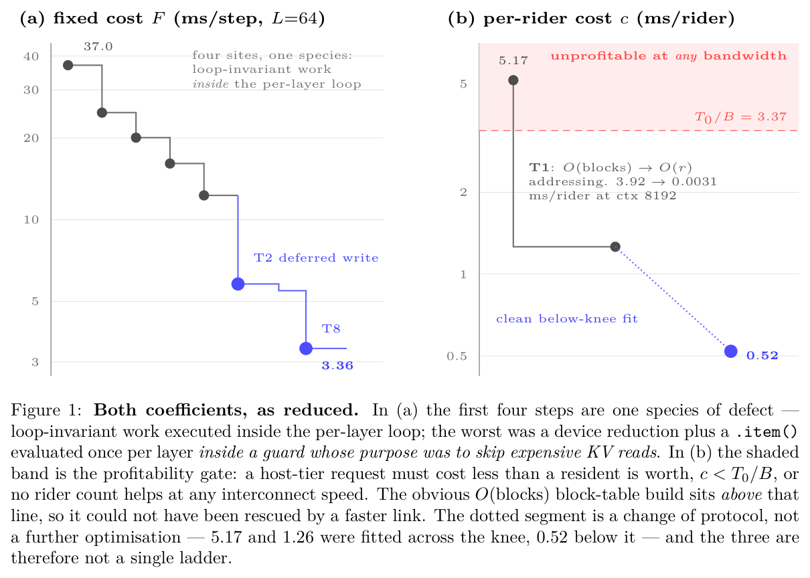

# Co-serving a host-DRAM KV tier: architecture, flows, and the cost floor of a multi-tier KV system

Working document for agreeing chapters 3 and 4. Every number is measured and
sourced.

> ## The figures
>
> All seven are **inline below**, each where it is discussed. They are TikZ, authored
> once in `paper/tex/sections/fig-*.tex` so the paper and this document cannot drift
> apart; the PNGs here are rendered from those sources by
> `paper/figs/design/render.py`. `./paper/build.sh` compiles clean with all of them.
>
> | # | label | what it shows | where | status |
> |---|---|---|---|---|
> | 1 | `fig:arch` | the data path across both tiers | §1 | in the paper |
> | 2 | `fig:exec` | one layer, one forward pass | §4.2 | in the paper |
> | 3 | `fig:pipeline` | the $k$-slot rotation | §4.3 | in the paper |
> | **4** | `fig:addr` | three address spaces; the release/reissue hazard | §2 | **new** |
> | **5** | `fig:basevsopt` | **base vs optimised host path on one timeline** | §4.3 | **new** |
> | **6** | `fig:ladder` | both coefficients on log axes, against the gate | §5.1 | **new** |
> | **7** | `fig:fq` | the transfer-quantum axis, and its prediction | §6.3 | **new** |
>
> If you only look at two: **Fig. 5** carries the whole campaign, and **Fig. 6**
> shows the obvious implementation sitting *above* the line no bandwidth can rescue.
>
> A print copy of all seven is at
> `/mnt/beegfs/benishay/paper_versions/design-figures.pdf`.

---

## 0. What is in here, and which blocks are worth taking into the paper

| § | content | paper block? |
|---|---|---|
| 1 | the mechanism (Fig. 1) | **yes** -- §4 opener |
| 2 | memory and the three address spaces (Fig. 4) | **yes** -- §4, the forced-design argument |
| 3 | the six components and their state | reference only |
| 4 | the five main flows (Figs. 2, 5) | **yes** -- Fig. 5 is the highest-value new figure |
| 5 | base vs optimised: what the campaign changed (Fig. 6) | **yes** -- §6, as a before/after |
| 6 | **the cost floor, component by component, with costs** (Fig. 7) | **yes** -- new §3 subsection; this is the contribution |
| 7 | the shortlist of extractable blocks, with reasons | -- |
| 8 | defects found while writing | -- |

The six blocks I would argue hardest for are listed with reasons in §7. The one-line
version: **§6's floor table is the contribution**, and §5's before/after is what
licenses the claim that our costs are near the floor rather than merely measured.

---

## 1. The mechanism

***Figure 1** (`fig:arch`, source `paper/tex/sections/fig-arch.tex`) --- already in the paper.*

**Two tiers, one forward pass.** A **resident** keeps its whole KV in the paged pool,
exactly as unmodified vLLM would. A **rider** keeps its KV in pinned host DRAM and,
while generating, holds **zero blocks of the paged pool** -- its only device KV
footprint is a share of the `k`-slot rolling region, which every layer and every
rider shares.

**Why this is worth doing.** Decode is weight-bandwidth-bound: a step costs roughly
`(weights + KV read) / X_hbm`. Adding a row to an existing batch adds its KV read and
nothing else, so the weight read -- the dominant term -- is amortised over `B+r` rows
instead of `B`. Host DRAM is converted into **concurrency inside a step**.

A system that instead *pauses* a request while its KV is on the host and resumes it
later amortises nothing: the weights are still read for that request during its own
active phase. Co-serving buys per-step amortisation; time-multiplexing buys admission
over time. Only the first improves what decode is bound by.

**The enabling assumption: disaggregated prefill.** A rider's KV arrives from a
prefill instance straight into the host mirror, never materialising in device memory.
This is load-bearing, not convenient: vLLM charges allocation at *peak*, so a request
that prefilled into the pool and then released still raised the peak. In a combined
engine, once the device holds `capacity` residents the next request cannot prefill and
so never becomes a rider -- **riders could only be bought by giving up resident slots,
and the mixture could not beat all-resident at any link speed.**

---

## 2. Memory and the three address spaces

***Figure 4** (`fig:addr`, source `paper/tex/sections/fig-addr.tex`) --- **new**.*

### Why the mirror cannot be keyed by device block id -- the forced decision

The point of the feature is to **release** a rider's device blocks. Under vLLM's
allocator, releasing a block nulls the owner's block-table entry and returns the id to
a free list from which it is promptly reissued. A mirror keyed by *device* block id
would therefore, after a release:

1. **lose the read mapping** -- the owner's entry is now null; and
2. **alias** -- the reissued id now denotes a different request's data.

Both follow from the release, which is the thing we are trying to do. Hence a private
host space, freed only when the request finishes. An earlier version mirrored by
resident block id and **corrupted KV under block reuse**.

The predecessor design keys its compaction by resident block id *because it frees
nothing* -- which is why it validated the attention arithmetic and could never deliver
the capacity win. The property that makes the keying safe is the property that makes
the feature pointless.

**One thing not to overclaim.** The rolling region is allocated `k * 2 * w_max`
blocks, and the runner passes `w_max = h_max` (`gpu_model_runner.py:1387`) -- sized by
*policy maximum*, not by the live cohort. So the saving `(L-k)/L` holds **conditional
on the window tracking the cohort**; stated unconditionally it is wrong, and at
production settings that allocation does not fit. Every measured run set the override.

---

## 3. The six components

| component | file | owns |
|---|---|---|
| host pool + extent allocator | `hybrid_rungd_pool.py` | private host block space; the pinned mirror; one contiguous extent per request |
| rolling device region | same | `k` layer-slots, shared by all `L` layers; layer `l` uses `l mod k` |
| per-step compaction | same -- `build_step`, `_plan_extents` | host-id to compact-id map; the transfer runs; **one** block table and `seqused` per step |
| deferred token-write | same -- `write_token`, `flush_token_writes` | pinned staging; the pending list; the event |
| two-source attention | `flash_attn.py:_pool_cpu_override`, `kv_tier_backend.py` | the second attention call; the gather/scatter; the backend protocol |
| admission + migration | `transfer_aware_admission.py` | tier assignment; the hide budget; demote/promote with a revert probe |

The `KVTierBackend` protocol matters beyond tidiness: it separates *which requests
live where* (policy) from *how non-resident KV is stored and read* (mechanism), and
admits a zero-copy host-reading kernel in the same slot. That is the sense in which a
competing mechanism is a **substitutable component** rather than a rival system.

Two admission details worth keeping in the chapter:

- The hide budget is an EMA of step time taken **only on steps with zero riders**.
  Otherwise a step already slowed by rider transfer enlarges the budget that admitted
  those riders -- a loop that inflates itself.
- Tier affinity is **temporal, not contextual** -- idle time and remaining generation,
  not sequence length. Offloading frees bytes proportional to context *and* costs link
  bytes proportional to context every step, so **context cancels** and cannot
  discriminate between tiers at all. The same cancellation drives the gain law in §6.

---

## 4. The main flows

### 4.1 Admission and tier assignment

> **Admission**, as a decision: a free resident slot plus the `arrival` policy gives
> `hbm`; otherwise `host_affinity = w*idle + (1-w)*remaining` against a threshold;
> otherwise the B1 byte roofline `sum_i b_tok*S_i <= budget_ms * X * (1-margin)`, and
> a failure means the request waits rather than becoming a rider.

Then, each step, under the scored policy only:

> **Migration**, under the scored policy only: demote above `0.95*SLO`, promote below
> `0.70*SLO`, and **every demotion opens a probe** against `min(EMA window)` that
> reverts after 16 steps if ITL got worse, then doubles its backoff.

The probe exists because **the byte roofline cannot see the host path's fixed
per-step cost**: a byte-legal demotion was measured driving ITL from ~6 to ~24 ms.
The baseline is the recent *minimum* of the EMA window, not the instantaneous EMA,
because the instantaneous one picked up startup transients and made a harmful
demotion look like an improvement.

### 4.2 The decode step

***Figure 2** (`fig:exec`) --- already in the paper. The tables below give the full order.*

**Two things this makes visible, both of which the paper currently gets wrong.**

1. **The block table is built once per step and reused by every layer.** Only the slot
   *contents* rotate; a whole-plane rotation is a base-pointer change. So **the
   rolling window costs zero per-layer addressing work**. `04-design.tex:113` already
   says this, while `H-ridercost.tex:128` claims fusing would need a per-layer rebuild
   on the hot path. The second claim is wrong, and it makes fusion look harder than it
   is.
2. **The resident cohort is not isolated from the riders.** L2 runs over all `B+r`
   rows and L6 overwrites the rider rows. "Two tiers, two disjoint passes" describes
   the predecessor and is **wrong for the shipped path**, which is one full pass plus
   a rider override (`gpu_model_runner.py:1139` -- the resident index set is empty).
   Not masking the rider rows at L2 costs 22% of wall time.

### 4.3 The pipeline: how the transfer hides -- BASE vs OPTIMISED

This is the diagram the chapter needs most, because it is where the campaign's whole
gain lives.

***Figure 5** (`fig:basevsopt`, source `paper/tex/sections/fig-basevsopt.tex`) --- new, and the most valuable of the four.*

***Figure 3** (`fig:pipeline`) --- already in the paper. Why panel (b) above can prefetch at all: a slot survives $k$ layers, so layer $\ell{+}1$'s refresh is in flight while layer $\ell$ reads.*

**The quantum trade, in one line.** The rolling region holds `k` slots so that one
slot can be filled while another is read. The quantum you pipeline at -- here, one
layer -- sets **both** the device footprint **and** the amount of compute available to
hide the transfer behind, in opposite directions. §6.3 makes this the organising axis
of the design space.

### 4.4 The token write-back -- BASE vs OPTIMISED

> Folded into **Figure 5**: the write-back is the `D2H` and `host` rows of both
> panels, and the deferred flush is the box at the next step's boundary.

Two subtleties the chapter should carry:

- **Correctness is why the deferral is safe, and it is tight.** `_issue_runs` re-reads
  the mirror on the hot path *next* step, so the scatter must land before it -- which
  is exactly why `flush_token_writes` is the first thing `build_step` does.
- **Ordering the scatter after its readers costs the entire overlap.** The correct-by-
  construction fix (`MIRROR_SYNC=1`) moves the per-rider cost from ~0.9 to ~7.0 ms,
  because the copy stream always has outstanding work, so synchronising it is close to
  a full device sync. The hazard is intrinsic to the host running a step ahead of the
  device.

### 4.5 Seeding, reclaim, promotion

> **Seeding** is `preload_req` (external delivery, never touches HBM) or `seed_req`
> (gather from the request's own resident blocks). Either way the pool blocks are
> released **only** after the worker acknowledges, via
> `ModelRunnerOutput.kv_tier_seeded_req_ids`. **Promotion** is two-phase: mark and
> refill the block-table holes the cap left, gate on *non-null* entries
> all-or-nothing, then commit and copy host to resident before attention.

Three vLLM behaviours force this shape:

- **The scheduler cannot observe a host-side write**, so anything conditioned on KV
  having arrived must wait for a worker acknowledgement.
- **The waiting queue stops at the first request it cannot allocate for**, so a
  block-starved request ahead would otherwise block an admission that needs no
  resources -- hence a queue bypass.
- **Block accounting is length-based**, so a nulled entry still counts as present: a
  promotion gate asking "do the blocks cover the sequence?" **passes on an all-null
  table and serves garbage.** Refill is therefore all-or-nothing and the gate counts
  non-null entries.

---

## 5. Base vs optimised: what the campaign changed

### 5.1 The two phases, with their measured coefficients

***Figure 6** (`fig:ladder`, source `paper/tex/sections/fig-ladder.tex`) --- **new**.*

The four pre-campaign sites were **one species**: loop-invariant work executed inside
the per-layer loop. The first is the best story in the project -- a device reduction
plus a `.item()` evaluated once per layer **inside a guard whose purpose is to skip
expensive KV reads.** An optimisation was paying a full pipeline drain per layer to
decide whether to optimise.

> **Do not chain the three points in panel (b).** The `5.17` and `1.26` figures are fits that
> included points above the knee; the `0.52` is a clean below-knee fit. They are
> separate measurements of the same quantity under different protocols, not a
> sequence. The honest statement is: T1 cut the addressing term by ~1234x at the
> target context, and the final coefficient, measured properly, is 0.52 ms/rider at
> `L=64`.

### 5.2 The ledger: nine attempted, four landed

| | change | outcome |
|---|---|---|
| **T1** | `O(r)` addressing from the extent guarantee | **landed**: 3.917 -> 0.00313 ms/rider at ctx 8192, and the term **loses its context dependence** |
| **T2** | deferred, batched mirror write | **landed**: `F` 13.4 -> 5.8 ms |
| **T7a** | one pinned allocation, vectorised scatter | **landed**: -0.32 ms |
| **T8** | stop a disabled feature flushing per layer | **landed**: -2.0 ms, the largest single win |
| T3 | staged D2D then one strided D2H | rejected: **6x worse**, 4.6 vs 22.3 GB/s |
| T4 | batch the crossings across layers | rejected unbuilt: **18% worse** off-engine |
| T5 | whole-extent runs | **null**: launches /8, neither coefficient moved |
| T6 | order the mirror scatter after its readers | rejected: costs **the entire overlap** |
| T7b | preallocated rider buffers | null |

**T8 was a defect, not an optimisation.** A feature that is **off by default** -- the
swap-semantics emulation -- was flushing the batched mirror write **64 times per
step**, because its call site tested that the method *existed* rather than that the
feature was *enabled*. It had silently defeated T2's batching from the day T2 landed,
and it was found only because T7a, a change that should have helped, did not.

**The meta-result, and it belongs in the paper.** **Four of the nine had a mechanism
that demonstrably fired and a benefit that did not follow.** T5 cut the launch count
eightfold and moved nothing -- which is what refuted the launch-bound account of `F`.
T3 achieved exactly the bandwidth improvement predicted for it in isolation and was
six times slower in the engine. So: **a confirmed mechanism is no evidence at all
about a cost**, every remaining candidate is priced off-engine or by ablation before
it is built, and the microbenchmark that prices them **carries T3 itself as a
known-bad control** and must reproduce the regression before it is trusted.

### 5.3 What `F = 3.36 ms` is made of now

| component | ms at L=64 | how obtained |
|---|---|---|
| second attention call | **1.21** | direct ablation, same job, 3 baselines agreeing to 0.09 |
| -- of which kernel + launch | 1.16 | `nokernel` arm |
| -- of which gather/scatter | -0.05 in `F`, **+0.134 in `c`** | `noattend` minus `nokernel` |
| everything else fixed | **2.15** | by difference |
| -- of which the `2L` D2H launch pattern | 0.834 | off-engine, `launch_pattern_bench` |
| -- unattributed | ~1.3 | **open** |

The gather and scatter **size with the rider count**, so they live in `c`, not `F` --
which is why subtracting them inside `F` returns a zero. An `F`-only decomposition
cannot see them, and that is why the earlier +10-point fusion estimate was wrong.

---

## 6. The cost floor of a multi-tier KV system

### 6.1 What any such system must do

Independent of implementation, a system serving a request whose KV is not in device
memory, in the same forward pass as requests whose KV is, must:

> The seven obligations are the `#` column of the floor table in section 6.2; each is
> listed there with its floor, our base cost, our optimised cost and a verdict.

### 6.2 The floor, our base, and our optimised cost

This is the table the paper needs. `S` = context, `r` = riders, `L` = layers,
`X` = achieved link bandwidth, `b_tok` = bytes per token of KV.

| # | component | **floor** | our **base** | our **optimised** | at the floor? |
|---|---|---|---|---|---|
| C1 | link bytes | `b_tok * sum_i S_i` per step | identical | identical | **yes** -- identity |
| C2 | exposure | `>= 1` quantum per rider (nothing prefetches across the step boundary) | **all of it** -- issued inline | `1/L` of the byte time, 0.0075 ms of a 0.61 ms `c` | **yes**, to measurement resolution |
| C3 | device residency | `2q`; saving `= 1 - k*q/L` | `k=4` -> `4/64` | `k=4` -> `4/64` | **no** -- `k=2` measures the same (§8.4) |
| C4 | HBM passes | `2x` staged, `1x` direct | `2x` | `2x` | **at the staged floor**; `1x` needs a different mechanism |
| C5a | addressing metadata | `O(r)` per step | `O(blocks)`: **3.917 ms/rider** at ctx 8192, growing with `S` | **0.00313 ms/rider**, context-independent | **yes** -- 1234x, and the right complexity class |
| C5b | tier dispatch | 1 extra dispatch per layer in a fixed-kernel ecosystem | 1.21 ms | 1.21 ms | **yes** for a fixed kernel; a custom kernel saves the launch half (1.16) |
| C5c | row gather/scatter | `0` if rider rows are batch-contiguous | 0.134 ms/rider | 0.134 ms/rider | **no** -- reachable by batch reorder, not yet done |
| C6 | ordering ops | `Omega(L)` per step for a copy-engine pipeline; `0` intra-kernel | `2L` **blocking** syncs | `L` stream waits + `L` event records, **non-blocking** | **yes** for a copy-engine design |
| C7a | transfer launches | `2L` (the 2 from separate K/V tensors) | `2rL` | `2rL` (`2L` with whole-extent, default off) | **no** -- factor `r` is allocator fragmentation |
| C7b | host-side gather | `0` with a contiguous layout | **22 ms/layer** -- 98% of `stream_layer`, 72% of engine wall | **0**; 1.38 ms/layer transfer at 24.38 GB/s | **yes** -- the layout removes the cost entirely |
| C7c | write-back crossings | `O(1)` per step | `2L` **blocking** | `2L` **async**, deferred, batched | **no** -- `O(1)` is open; T4's route is 18% worse |
| C7d | mirror scatter | `O(1)` per step | `2L` per-layer | **2** vectorised | **yes** |

**Scorecard: at or near the floor on 7 of 12; three open with a known route; two
open with no known route.**

- **Closed and at the floor:** C1, C2, C4 (staged), C5a, C5b (fixed kernel), C6, C7b,
  C7d.
- **Open, route known, not yet built:** C5c (batch reorder -- worth 0.134 ms/rider),
  C7a (tighter extents -- the mechanism exists and is default-off), C3 (`k=2`
  instead of 4 -- halves the residency charge for no measured cost).
- **Open, no known route:** C7c (`O(1)` crossings -- the one path we priced is worse)
  and C4 at `1x` (needs a zero-copy kernel, i.e. a different mechanism).

### 6.3 The organising axis: `f` and `q`

The twelve rows above collapse onto two design parameters:

***Figure 7** (`fig:fq`, source `paper/tex/sections/fig-fq.tex`) --- **new**.*

> **`q` sets both the device footprint and the compute available to hide the transfer
> behind, and it sets them in opposite directions.** That is the trade no multi-tier
> design escapes.

And `f` = the fraction of a request's KV that is non-resident, which is what you save.
Placements: ours `f=1, q=layer`; DirectKV `f=1, q=tile`; Pie `f=m/L, q=layer` with a
two-buffer window. The paper's related-work table already sorts the field by *axis of
partition*; this supplies the missing **reason** -- and it *predicts which link each
design needs*, which is a design-space result that does not depend on our speedup
being real.

### 6.4 When the mechanism pays, in parameters only

- A rider must cost less than a resident is worth: **`c < T0/B`**. Below that, no rider
  count helps at any bandwidth. This is the gate that the `O(blocks)` build failed:
  5.17 against a 3.37 ms budget, so **no interconnect at any bandwidth could have
  paid.**
- Usable rider count is **`floor(r*)`**, `r* = T0*X/(S*b_tok)` -- an integer, so gain
  is a **sawtooth** in context, and it contains no `k`.
- Gain tracks **how much of device memory the weights took**, not context: context
  appears in both the memory freed and the bytes moved, and **cancels**. The same
  cancellation forces the admission policy to score on time rather than length.

---

## 7. The blocks I would take into the paper

| block | from | why it earns space |
|---|---|---|
| **1. The floor table** | §6.2 | the contribution. It is the only thing here that is about the *class* of systems rather than about ours, and the base/optimised columns are what license "our costs are near the floor" instead of merely "we measured our costs". |
| **2. The `(f,q)` axis** | §6.3 | turns related work from a list into one curve, and makes a *prediction* (which link each design needs). Costs half a page and a diagram. |
| **3. Base vs optimised pipeline** | §4.3 | one diagram carries the whole campaign: inline-and-blocking becomes prefetched-and-deferred, and the 22 ms host gather disappears. Nothing else explains the 37.0 -> 3.36 as well. |
| **4. The forced address space** | §2 | the cleanest "forced by the substrate" argument we have, and it ends in a corruption bug, which is persuasive. |
| **5. T8 and the meta-result** | §5.2 | four of nine mechanisms fired without a benefit; the largest win was a defect. This is the methodological contribution and it is genuinely transferable. |
| **6. The `c < T0/B` gate** | §6.4 | a one-line design rule with a quantified failure: the obvious implementation misses it by 1.5x, so no link could save it. |

Not worth space: the per-flow detail of §4.5, the component inventory in §3, and the
retraction history -- all reference material.

---

## 8. Defects found while writing, in priority order

**8.1 `07-related.tex:24` makes a provably false claim about an OSDI paper.** It says
of DirectKV "they pay no device memory and get no overlap". DirectKV's abstract claims
"warp-level pipelining to overlap KV fetching, computation, and write-back" and it has
a section measuring it. Our own `F-coherence.tex:19` states the correct version -- a
window of one tile, with almost no arithmetic to hide behind. **Fix the body to the
appendix's wording.** The same sentence also carries the retracted "hide about 90% of
the transfer", which appears again at `C-related.tex:238`. Most damaging item in the
paper.

**8.2 The SuperInfer claim is sourced to an abstract.** `refs.bib` says so explicitly
and says to read the body first; there is no local copy. The claim it supports -- that
a rotated-out request is not generating -- is the one separating us from the closest
competitor.

**8.3 `H-ridercost.tex:128` overstates the obstacle to fusing.** It claims a fused
call needs "the rider cohort's table rebuilt per layer on the hot path". The table is
built **once per step** and reused by every layer (§4.2); a fused formulation needs
`k` tables per step, not a hot-path rebuild. Same error in
`OVERHEAD_CHARACTERISATION.md:816`. This makes our own backlog look harder than it is.

**8.4 `04-design.tex:143` mislabels a prefetch ablation as a `k>1` ablation**, and
`k=4` is unjustified. Both arms of the 0.92-vs-7.20 comparison ran `k_window=4`; what
varied was the side-stream prefetch. And the one `k` sweep we have reads
61.24 / 62.10 / 61.91 ms at `r=1` for `k` = 2 / 4 / 8 -- **`k=2` marginally best**, all
within drift -- while `killer_v2.py` charges every rider `4/64` of device memory for
`k=4`.

**8.5 `H-ridercost.tex` still says "across seven arms the per-rider cost repeats to
1.5%".** Across twelve arms of one configuration it spans 0.414-0.538, i.e. **+-12%**.

**8.6 `08-discussion.tex:53`** -- "bounded below by 0.83 ms of unavoidable copies".
Not a bound: that is our launch pattern's cost on this host, and the count floor is
`O(1)` per step (§6.2, C7c).

**8.7 `overhead_model.py:112` and `fusion_bound.py:37`** still carry **1.94** for the
second attention call. That was a *residual* -- `F` minus the mirror write minus the
streaming -- then **attributed** to the call. Direct ablation says the call is **1.21**.
So the residual is not simply wrong; **~0.7 ms of it is something else and is
currently unattributed**, and §6.2's C6 ordering operations are the obvious candidate.
Needs a decision, not a blind edit.

**8.8 `REVIEW_PROCESS_20261008.md`** was never amended after the
retraction-of-the-retraction, so it reads as though the headline is withdrawn to a
range including no benefit. The settled position hours later is x1.2-1.4 for the two
weight-heavy configurations.

**8.9 `E-implementation.tex`** still presents the launch-bound account of `F` as fact,
contradicting `05-implementation.tex` and `06-evaluation.tex` -- and contradicting T5,
which cut launches eightfold and moved nothing.

**8.10 `ORCHESTRATION_TAX_PLAN.md`** header still reads "Status: active" with the dead
+62%/+105% claim; the nullification is 300 lines down. `09-overhead.tex` is correctly
headed stale and excluded from the build -- listed so it is not "fixed" by accident.
