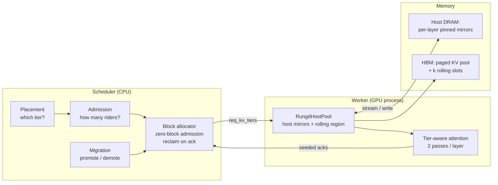
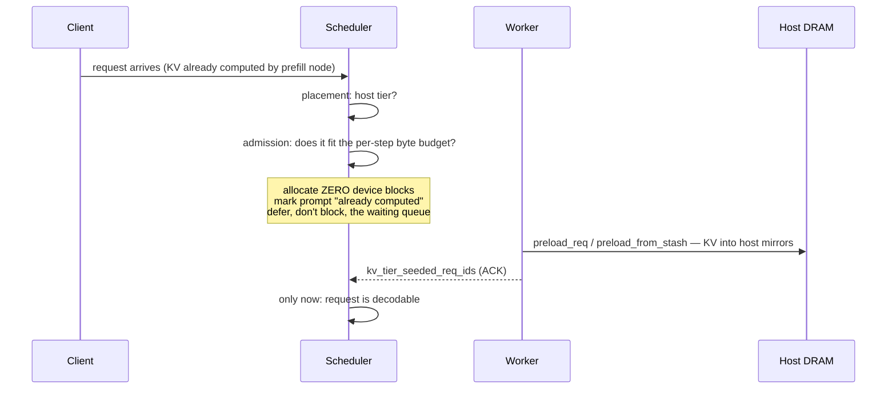
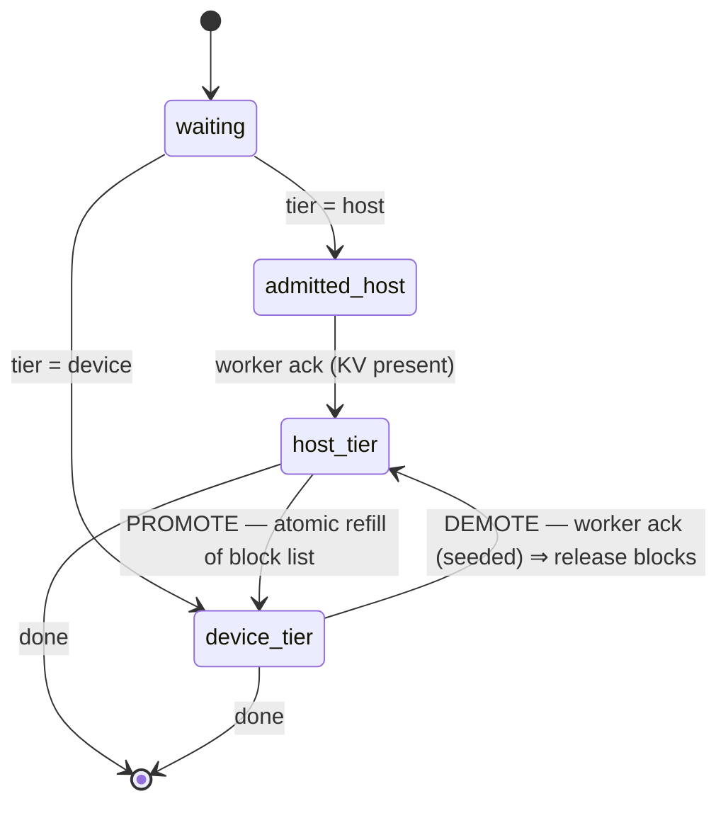

# Architecture: a heterogeneous KV memory for LLM decode

Written 2026-09-09, from the code rather than from the paper. Every mechanism
below names the file and function that implements it, so each claim can be
checked. Where I say "we chose X", the alternative and the reason it lost are
stated — those are the parts that are hard to reconstruct later.

---

## 0. The one-paragraph version

A decode server's batch size is capped by HBM, because KV cache fills the device
long before the arithmetic units are busy. The machine has a second, much larger
memory — host DRAM — that a coherent interconnect now makes fast enough to read
from during decode. **We manage HBM and host DRAM as a single KV store.** Each
request is placed in one tier or the other. Device-tier requests behave exactly
as in stock vLLM. Host-tier requests hold **no HBM blocks at all**: their KV
lives in host DRAM and each layer's slice is streamed in just before that
layer's attention needs it, into a small rotating buffer shared by all layers.
Both tiers are served in **one forward pass**, so the model weights are read
once no matter how the batch is split.

---

## 1. Why we built it this way

The chain of reasoning, in order, because each step constrains the next.

**(a) The binding constraint is capacity, not compute.** At the operating point
that matters — pool full, scheduler refusing requests — a decode step is roughly
79% KV read and 21% weight read, and arithmetic intensity is the GQA group size
(4–8), against a hardware balance point near 116 FLOP/byte. The GPU is idle in
the only sense that matters: it could be serving more requests and cannot.

**(b) The spare resource is *time*, not bandwidth.** During the ~21 ms a 32B
model spends reading its weights on GH200, nothing wants the CPU–GPU link. That
window is what a host-tier request's KV can cross in. This is why the technique
exists at all, and why it is worth *nothing* on a model whose weights are small
(an 8B model leaves 76 GB of HBM free — there is nothing to buy).

**(c) Therefore: place *requests*, not bytes.** The unit of placement has to be
something that can be entirely absent from HBM, or the capacity is not freed.
Half a request's KV in HBM still pins the blocks. See §7 for the alternatives we
rejected and §8 for the system that chose the other axis.

---

## 2. The system, at 10,000 feet



| Component | File | Responsibility |
|---|---|---|
| Host KV pool | `vllm/v1/hybrid_rungd_pool.py` | owns host block ids, mirrors, rolling region, streaming, writes |
| Tier backend | `vllm/v1/kv_tier_backend.py` | `KVTierBackend` protocol; `StagedHostBackend` today, `DirectKVBackend` slot |
| Tier-aware attention | `vllm/v1/attention/backends/flash_attn.py` | `_pool_cpu_override`, `_maybe_hybrid_two_pass` |
| Per-step split | `vllm/v1/hybrid_attn_ctx.py`, `gpu_model_runner.py` | publishes which batch rows are which tier |
| Placement / admission / migration | `transfer_aware_admission.py`, `scheduler.py` | the policy layer |

---

## 3. Where the two tiers actually run on the GPU

This is the question the paper does not currently answer, and the answer is
simpler than people expect.

**There is no SM partitioning. There are no separate streams of execution for
the two tiers.** Both tiers are rows of the *same* batch, and the GPU runs the
whole model over all of them. The only thing that differs is *where attention
reads its keys and values from*, and that difference is expressed as **two
sequential kernel launches per layer over disjoint row subsets**, not as a
spatial partition of the device.

Concretely, for one transformer layer with a batch of $B$ decode rows of which
$H$ are device-tier and $R$ are host-tier ($B = H + R$):

```
   ┌─────────────────────────── ONE FORWARD PASS ────────────────────────────┐
   │                                                                          │
   │  QKV projection      GEMM over ALL B rows        ← weights read ONCE     │
   │        │                                                                 │
   │        ├── flash_attn #1  rows 0..B-1  vs paged KV pool                  │
   │        │       host-tier rows have seqused_k masked to 1                 │
   │        │       (they read one key; their output is discarded)            │
   │        │                                                                 │
   │        └── flash_attn #2  rows [cpu_idx] vs rolling slot ℓ mod k         │
   │                gathered with index_select, scattered back with           │
   │                index_copy_ into the same output tensor                   │
   │        │                                                                 │
   │  O projection        GEMM over ALL B rows        ← weights read ONCE     │
   │  MLP                 GEMM over ALL B rows        ← weights read ONCE     │
   └──────────────────────────────────────────────────────────────────────────┘
```

Three consequences worth being explicit about:

1. **Every non-attention operation is shared.** QKV, O-projection and the MLP
   run once over the whole batch. A host-tier request costs nothing extra there
   — it is one more row in a GEMM that is memory-bound on the weights anyway.
   *This is the whole economic argument for the design.*

2. **The two attention calls are sequential on the same SMs.** Kernel #2 starts
   after kernel #1 retires. They are not concurrent and do not compete for SMs.
   Kernel #2's cost is proportional to $R$ and to the host cohort's context, not
   to $B$.

3. **Kernel #1 does not do wasted work for host-tier rows.** We mask their
   `seqused_k` to 1 (`flash_attn.py:1056–1077`, "opt #5"), so they attend a
   single key rather than their whole history. Before that optimisation, host
   rows were attended *twice in full* — once uselessly. That single change was
   worth 22% of wall time on A100.

**Why not one fused kernel?** A single attention call reading two different KV
regions would need a dual block table and a per-row region selector inside the
kernel. That is a kernel change we do not own, it forecloses swapping in
DirectKV's kernel later, and the measured cost of the two-call structure is the
gather/scatter (`index_select`/`index_copy_`), which is small and flat in
resident count. We measured it: the fixed per-step cost is 12.29 ms and its
decomposition contains no dominant term — it is ~640 small kernel launches, not
the gather.

---

## 4. What a "rider" actually is

"Rider" is our internal term for a host-tier request, and the metaphor is exact.

A decode step has a **fixed cost paid once regardless of batch size**: reading
every model weight from HBM. It also has a **per-request cost**: reading that
request's KV. A device-tier request pays its KV cost out of *HBM bandwidth*. A
host-tier request pays its KV cost out of *interconnect bandwidth* — a resource
that is otherwise completely idle while the weights are being read.

So a rider:
- occupies a **row** in the batch tensors (costs GEMM FLOPs, which are free here
  because decode GEMMs are memory-bound on weights);
- consumes **link bandwidth** during a window when nothing else wants it;
- consumes **almost no HBM** — only its share of the rolling region, which is
  $k$ slots deep regardless of layer count, so about $k/L \approx 6\%$ of what a
  resident request needs at $k{=}4$, $L{=}64$.

It "rides along" on a step that was going to happen anyway, for the resident
cohort. The limit on riders is not HBM and not FLOPs — it is how many bytes the
link can move inside one step. That is exactly what the admission controller
computes.

**The honest edge of the metaphor:** riding is not free. Each rider adds a
measured 4.45 ms on PCIe (of which ~78% overlaps compute), and using the host
path at all costs a fixed 12.29 ms per step. On PCIe those costs exceed the
benefit. On a link 18× faster the per-rider term collapses and the fixed cost is
what sets break-even.

---

## 5. Memory layout, and why the host has its own addresses

### 5.1 Two address spaces

```
HOST DRAM                                   HBM
─────────────────────────────────────       ────────────────────────────
host_k[ℓ] : [H_max, b, n_kv, d_h]  pinned   paged KV pool  (device blocks)
host_v[ℓ] : [H_max, b, n_kv, d_h]  pinned   rolling_k[0..k-1] : [W_max, b, n_kv, d_h]
   ↑ indexed by HOST BLOCK ID                rolling_v[0..k-1] : [W_max, b, n_kv, d_h]
   ↑ one pair PER LAYER                          ↑ shared by ALL layers, ℓ mod k
```

**The host mirror is not indexed by device block id.** This is the single most
consequential decision in the system, and it is forced.

The point of the host tier is that a host-tier request's device blocks are
*released for other requests to use*. In vLLM, releasing a block nulls the
owner's block-table entry and returns the id to a free list, from which it is
promptly reissued. If the mirror were keyed by device block id, then after the
release we would (i) have **lost the read mapping** — the request's block table
no longer records where its data was — and (ii) **alias**, because the reissued
id now names a different request's data, so one request's stream would overwrite
another's.

So each `(request, logical block)` gets a **host block id** from a private
space, held until the request finishes (`ensure_req`, `free_req`). Device ids
churn freely underneath. Growth needs no device allocation: a new logical block
gets a fresh host block and its tokens arrive via the per-layer write path.

*We learned this the hard way — an earlier version mirrored by resident block id
and corrupted KV under block reuse. It is in the code comments at the top of
`hybrid_rungd_pool.py`.*

### 5.2 Block-major, split K and V

Each mirror is `[blocks, block_size, n_kv, head_dim]` — **block dimension
first** — and K and V are **separate tensors**.

The reason is DMA. A run of consecutive host blocks must be **one contiguous
byte range** on both sides, or the transfer cannot be a plain pinned DMA and
degrades into a host-side gather. We measured that: with the old
`[2, blocks, ...]` layout, the gather cost **22 ms per layer**, which was 98% of
`stream_layer` and 72% of engine wall time. Fixing the layout took the CPU
gather from 10,096 ms to 39 ms in one benchmark.

This mattered more than it looks: 22 ms/layer is a *host memcpy*, and a faster
interconnect does not fix it. On GH200 the old code would have spent ~393 ms/step
gathering to hide ~2 ms of transfer, and we would have concluded that C2C
doesn't help while actually measuring our own memcpy.

### 5.3 The rolling region

$k$ pairs of device tensors, each sized to $W$ blocks — the **active cohort's**
footprint this step, not the host pool's size. Layer $\ell$ uses slot
$\ell \bmod k$.

$k$ slots (not one) is what allows the transfer to be hidden: a slot is not
overwritten until $k$ layers later, so the refresh for layer $\ell{+}1$ can be
in flight while layer $\ell$ is still reading its own slot. With $k=1$ transfer
and compute serialise.

---

## 6. The flows

### 6.1 Admission — how a request enters the host tier



The ack matters. **The scheduler cannot observe a host-side write.** If it
admitted (or, on the demotion path, released blocks) on the assumption that the
KV had landed, a failed transfer would leave a request with no KV anywhere. Every
transition that depends on "the KV is in DRAM" is driven by a worker
acknowledgement carried back in `ModelRunnerOutput.kv_tier_seeded_req_ids`.

Three scheduler behaviours must agree for a host-tier request to hold no device
blocks, and **all three are necessary** — the third we found only by testing:

1. **Admit with an empty block list.**
2. **Declare the prompt already computed**, so no prefill is scheduled and
   nothing is allocated even transiently. The batch is bounded by *peak* device
   residency, so allocate-then-reclaim still pays the peak.
3. **Queue bypass.** vLLM's waiting loop *stops at the first request it cannot
   allocate for*. A host-tier request needs nothing — but a block-starved
   request ahead of it in the queue would still block it. A request that cannot
   be allocated is now deferred so the scan continues.

### 6.2 A decode step

Two granularities. **Addresses are fixed for the whole step; contents change
every layer.** Separating them is what keeps per-layer work small.

**Once per step — compaction** (`RungdHostPool.build_step`):

```
active host-tier cohort:   A:{7,8}   B:{23}   C:{40,41,42}

sorted union       →  [7, 8, 23, 40, 41, 42]          W = 6
compaction map     →  7→0  8→1  23→2  40→3  41→4  42→5
maximal runs       →  (7→0, len 2)  (23→2, len 1)  (40→3, len 3)
                      ⇒ 3 contiguous slice copies, not 6 scattered ones

compacted block table:   A [0,1]    B [2]    C [3,4,5]
```

Built once; every layer reuses it. The run decomposition is what makes the
transfer a handful of `cudaMemcpyAsync` calls straight out of pinned memory —
**the DMA engine performs the compaction**.

**Once per layer** (`stream_layer`, `write_token`, then the two attention calls):

```
time ──────────────────────────────────────────────────────────────►
compute   │ layer 0    │ layer 1    │ layer 2    │ layer 3    │
H2D       │ ℓ=1 → s1   │ ℓ=2 → s2   │ ℓ=3 → s3   │ ℓ=4 → s0   │
            ^ refresh for the NEXT layer is in flight while this one computes
            slot = ℓ mod k (k=4): a slot survives k layers before reuse
```

1. **Refresh** — issue the runs into slot $\ell \bmod k$. Double-buffered:
   `_launch_prefetch(ℓ+1)` is issued and waited on with a CUDA event.
2. **Attend** — the two passes of §3.
3. **Write** — this step's new $K,V$ go to the host mirror (**authoritative**)
   *and* into the current slot, so this step's own attention sees them.

### 6.3 Migration



The interesting part is the **gate**, and it is measured rather than predicted.

An open-loop cost model — "does this request's transfer fit the remaining
budget?" — is **necessary but not sufficient**. The budget counts transfer
bytes; the host path also has a per-step cost *independent of how many bytes
move*. A gate that sees only bytes cannot see that cost, and widening the margin
does not fix it. We measured this: the roofline approved a demotion that made
ITL four times worse.

So a demotion is a **probe**: record the best recent steady-state ITL, demote,
wait, compare; if it regressed beyond a margin, promote back and grow the
cooldown exponentially. Two details were forced by the noise floor — the
baseline must be a recent **minimum** (an instantaneous EMA absorbs startup
transients and scores a harmful demotion as good), and the loop needs a warmup
or the first probe fires before any steady state exists.

---

## 7. Design alternatives we rejected, and why

| Alternative | Why it lost |
|---|---|
| Mirror keyed by **device block id** | Block release nulls the table and the id is reused → lost read mapping + cross-request aliasing. Measured as KV corruption. |
| **Single fused** attention over two regions | Needs a dual block table and per-row region select *inside* the kernel; forecloses swapping in a zero-copy kernel; the two-call cost is small and flat in resident count. |
| **Block-table redirect** within the main pool (no second region) | Cannot save memory: it relocates rows inside one full-size per-layer tensor, so all $L$ copies stay resident. Saving requires a *second physical region* shared across layers. |
| Cap block **growth** only (no reclaim) | A host-tier request keeps its whole prefill in HBM → frees ~11% and still pays full interconnect. Strictly worse than leaving it resident, at any link speed. |
| **Combined** prefill+decode engine | Peak residency, not steady-state, bounds the batch. Riders and residents then compete for the same headroom and the served total never passes the all-HBM capacity. Hence the P/D decode-node setting. |
| Placement by **context length** | Freed bytes and per-step cost both scale with $S$ → cancels exactly. Equivalent to ranking arbitrarily. The discriminating signal is temporal (idle time, remaining generation). |

---

## 8. How this differs from Pie — and from DirectKV

### 8.1 Pie (Xu et al., UC Berkeley, arXiv:2411.09317)

This is the closest prior work to our *mechanism*, and the comparison is worth
getting exactly right. Pie also targets GH200, also stages KV through GPU
buffers, also prefetches per layer to overlap transfer with compute. Our rolling
region and their swap buffers are cousins.

**The difference is the axis of partition, and it is total:**

```
        PIE                                    OURS
   partition by LAYER                    partition by REQUEST

   req A  ███░░░  (layers 0-3 HBM,       req A  ██████  fully HBM-resident
   req B  ███░░░   layers 4-5 on CPU)    req B  ██████  fully HBM-resident
   req C  ███░░░   — same for everyone   req C  ░░░░░░  fully host-tier
                                          ↑ per-request placement decision
```

- Pie relocates **$m$ of $n$ layers** of the KV cache to CPU, "using per-layer KV
  cache as the basic management unit". This applies to **every request
  identically**. Their words: the capacity per layer is "the total KV cache
  capacity divided by the number of logical layers".
- **Pie has no per-request notion at all.** I checked their text: zero
  occurrences of "per-request", "request-level", or "request granularity". Their
  only control knob is the global expansion factor $m$ ("adaptive expansion"),
  tuned to keep $t_{swap} \times m \le t_{compute} \times n$.

Why that matters, concretely:

1. **Pie cannot free any request's KV entirely.** Every request keeps
   $(n-m)/n$ of its KV resident, always. There is no configuration in which
   request C is absent from HBM while A and B are fully resident.
2. **Pie spends interconnect uniformly.** Its per-step swap volume is $(m/n)$ of
   the KV of *all* requests. Ours is the KV of the *selected* requests only —
   so at the same link budget we choose *which* requests to spend it on. That
   choice is the thing our paper is about, and Pie does not have it.
3. **The two axes are orthogonal and could compose.** One could run Pie's
   layer-split within our device tier. We should say so rather than claim the
   territory.

**One number of theirs we should use.** Pie *measures* GH200 C2C at
**419 GB/s CPU→GPU and 371 GB/s GPU→CPU** — an independent confirmation that the
900 GB/s headline figure is bidirectional and that ~450 GB/s per direction is
the right bound (they measure below it, as we should expect). Our own projections
were divided by 900 until 2026-09-05; Pie's measurement corroborates the fix.

Pie reports up to **1.9× throughput and 2× latency** over vLLM, and 1.67× lower
GPU memory at equal performance.

### 8.2 DirectKV (OSDI'26)

Different again: a **zero-copy attention kernel** that reads CPU-resident KV
directly, with no staging buffer. It places **100% of KV on the host for every
request always** (§6 + Alg. 3), which is why it needs no scheduler — and its
§8.1 says explicitly that it "does not change scheduling, batching, or
KV-management policies".

So the three systems sit at different points:

| | placement unit | who decides | HBM used for KV |
|---|---|---|---|
| stock vLLM / SGLang | — | — | 100% |
| **Pie** | layer (uniform) | global expansion factor | $(n-m)/n$ of every request |
| **DirectKV** | none (all host) | nothing | 0% |
| **Ours** | **request** | placement + admission + migration | resident cohort only |

**Correction (2026-09-10, Ben's challenge — the earlier version of this
paragraph was wrong).** It is tempting to say DirectKV's kernel would remove our
staging buffer as pure overhead. It would not, because the two designs hide the
transfer behind *different things*:

| | hides the fetch behind | window size |
|---|---|---|
| DirectKV (zero-copy) | the attention tile it is computing (warp pipelining) | one tile |
| **Ours (staged)** | **the entire compute of the previous layer** | **QKV + attn + O + MLP** |

Decode attention's arithmetic intensity is the GQA group size — 4–8 FLOP/byte
against a balance point near 116 — so there is essentially **no arithmetic
inside the attention kernel to hide a CPU fetch behind**. The layer's GEMMs, by
contrast, are weight-bound and long (~21 ms of a 34 ms step for Qwen-32B on
GH200). **The rolling region is not a tax; it is what buys a layer-sized hiding
window instead of a tile-sized one.**

The real relationship is a **crossover in the offload ratio**:

- Transfer **fits** the layer compute window → staging hides it, paying only 2
  extra HBM passes per byte (~0.15× the link time each). **Staged wins.**
- Transfer **exceeds** the window → exposed either way; zero-copy avoids the
  extra HBM passes and the buffer footprint. **Zero-copy wins.**

DirectKV offloads **100% of KV for every request**, so its per-step transfer is
the whole working set and can never fit a compute window — zero-copy is correct
*for their design point*, and their CPU-memory-aware tiling exists to shift the
residual bottleneck back to HBM. We offload a **selected subset**, sized by
admission to fit the window. **The offload ratio is the thing our policy
controls**, so the mechanism follows from the policy rather than constraining
it.

What a coherent link *does* buy us regardless is the **write path**: new $K,V$
could be written straight into mapped host memory, removing the explicit D2H
and the two-copy bookkeeping. DirectKV's Alg. 3 already does this.

`KVTierBackend` still exists to allow the swap — but as a choice to make at a
measured crossover, not an upgrade to take unconditionally.

---

## 9. How to check each claim against the code

| Claim | Where | Test |
|---|---|---|
| Compaction, runs, compacted block table | `hybrid_rungd_pool.py::build_step` | `rolling_region_unit_test.py` |
| Host pool round-trip is exact | `hybrid_rungd_pool.py` | `rungd_host_pool_test.py` (bitwise) |
| Two-pass attention == single pass | `flash_attn.py::_maybe_hybrid_two_pass` | in-server `=2` self-verify, 576 layer-steps, max\|diff\|=0 |
| Host-tier tokens match vanilla | end-to-end | `hybrid_rungd_real.py` (token-identical) |
| Blocks are actually reclaimed | `scheduler.py` + `KVCacheManager.reclaim_tier_blocks` | `rungd_reclaim_unit.py`; `hybrid_reclaim_correctness.py` (133 of 192 blocks) |
| Riders are additive | zero-block admission | `hybrid_preload_capacity.py` (8 → 48) |
| Rider cost decomposition | — | `rider_hide_efficiency.py` (12.29 ms fixed + 4.45 ms/rider) |
| Prefill handover is exact | `stash_from_host` / `preload_from_stash` | `prefill_stash_roundtrip.py` (bitwise) |

**Gotcha for anyone re-running these:** token-level comparison against the bench
connector is invalid — it fake-fills KV. And bf16 attention reductions are
batch-order dependent, so vanilla vLLM itself gives different text at
concurrency 1 vs 6. Use the in-process `=2` numeric verify, or compare serially.

---

## 10. Known limits

- **The staged path costs a fixed ~12.29 ms/step**, which an operator trace
  attributes to ~640 extra kernel launches per step (10 ops × 64 layers), not to
  any single hot spot. It is a floor of the *staged* design; a zero-copy backend
  removes it. Getting past it otherwise needs batching across layers.
- **The prefill transport is emulated**, not integrated with a production P/D
  stack. The handover is implemented and bitwise-verified; the network transport
  is not.
- **Speculative decoding is unsupported** on the pool path (query length must be
  1); the runner suppresses the resident write and warns.
- **Host memory pressure**: the pinned mirrors are real memory and sized to
  `max_num_seqs × ceil(max_model_len / block_size)`.
- **On PCIe the economics do not work** (−2.3% throughput). This is predicted,
  not a defect: the roofline said so before we built it, and DirectKV
  independently concludes that on PCIe theirs "should be viewed primarily as a
  capacity-extension mechanism".
